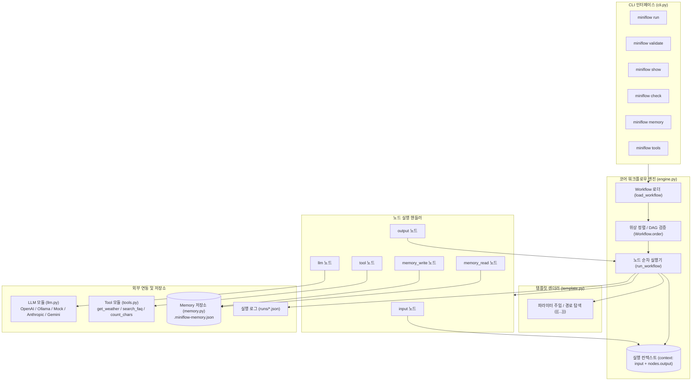
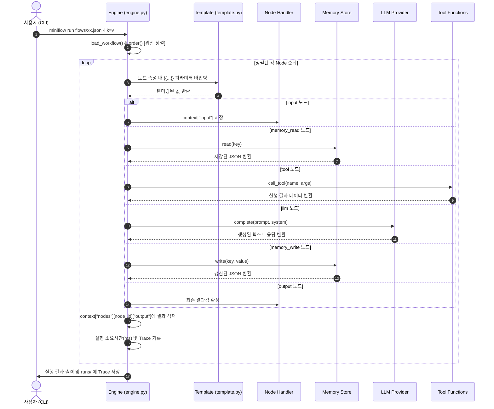
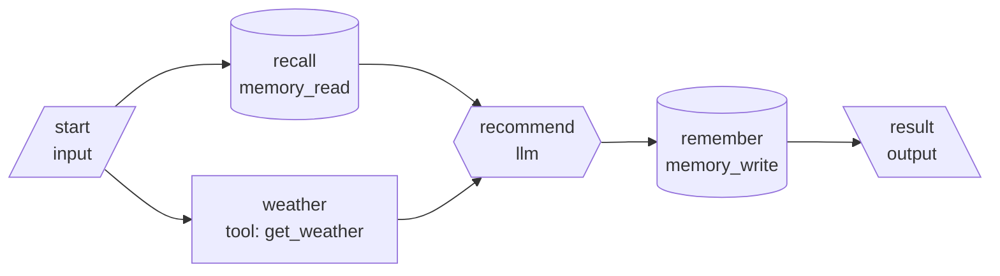

# miniflow (workflow-lab) 프로젝트 분석 보고서

## 1. 프로젝트 개요

`miniflow`(`workflow-lab`)는 복잡하고 무거운 노코드 워크플로우 툴(예: Dify, LangFlow 등)의 핵심 원리를 가볍게 이해하고 실습할 수 있도록 제작된 **JSON 기반 미니 AI 워크플로우 실행 엔진**입니다.

사용자는 JSON 파일로 노드(Node)와 노드 간의 연결 관계(Edge)를 정의하며, `miniflow` 엔진은 이를 비순환 방향 그래프(DAG)로 해석하여 순서를 결정하고 실행합니다.

---

## 2. 시스템 아키텍처

전체 시스템 구성 및 모듈 간 상호작용 구조입니다.



---

## 3. 핵심 컴포넌트 및 파일 구조

```
workflow-lab/
├── pyproject.toml              # 프로젝트 패키지 정의 및 의존성 (openai, dev: pytest 등)
├── README.md                   # 프로젝트 사용 설명서
├── data/                       # Tool 테스트용 로컬 데이터셋
│   ├── faq.json                # FAQ 데이터
│   └── weather.json            # 도시별 날씨 데이터
├── flows/                      # JSON 기반 워크플로우 정의 예제
│   ├── 01-llm-only.json        # 순수 LLM 호출 워크플로우
│   ├── 02-llm-tool.json        # LLM + Tool 연계 워크플로우
│   ├── 03-save-profile.json    # LLM + Memory 저장 워크플로우
│   ├── 04-recommend-with-memory.json # Memory 읽기 + Tool + LLM + Memory 쓰기
│   └── 05-tech-support-ticket.json   # 지원 티켓 분류 및 FAQ 검색 복합 플로우
├── runs/                       # 실행 결과 트레이스 로그 저장소 (JSON)
├── src/miniflow/               # miniflow 패키지 소스코드
│   ├── __init__.py             # 패키지 초기화
│   ├── cli.py                  # CLI 명령줄 파서 및 서브커맨드 구현
│   ├── engine.py               # 워크플로우 파싱, 위상 정렬(Kahn 알고리즘), 실행 루프
│   ├── envfile.py              # .env 파일 자동 탐색 및 로딩 유틸리티
│   ├── llm.py                  # 멀티 LLM Provider 호출 및 Fallback 처리
│   ├── memory.py               # 키-값 기반 영속 JSON 메모리 관리
│   ├── template.py             # {{...}} 문법 컨텍스트 바인딩 렌더러
│   └── tools.py                # 로컬 내장 도구(Tools) 모음
└── tests/                      # pytest 단위 테스트
```

### 소스코드 상세 역할

1. **`engine.py`**:
   - `Workflow`: 워크플로우 메타데이터, 노드, 엣지를 관리. Kahn's Algorithm을 활용해 진입 차수(Indegree) 기반 위상 정렬을 수행하고 사이클(Cycle)을 방지.
   - `run_workflow()`: 노드별 실행 시간 측정(`perf_counter`), 오류 트레이스, 상태 기록(`runs/` 저장용 데이터 생성).
   - `to_mermaid()`: 워크플로우 구조를 Mermaid 다이어그램 코드로 직렬화.

2. **`template.py`**:
   - `{{input.field}}`, `{{nodes.node_id.output.nested}}` 형태의 변수를 파싱하고 컨텍스트에서 값을 조회하여 문자열 또는 원본 객체 타입으로 치환.

3. **`llm.py`**:
   - 다양한 Provider 지원 (`openai`, `ollama`, `anthropic`, `gemini`, `mock`).
   - `MINIFLOW_LLM_FALLBACK` 환경변수를 통해 메인 Provider 실패 시 대체 Provider(예: Ollama 로컬 모델)로 자동 재시도하는 회복탄력성(Resilience) 제공.
   - API 키가 없어도 테스트 가능한 결정론적 Mock 룰 지원.

4. **`tools.py`**:
   - 네트워크 연결 없이 즉시 테스트할 수 있는 내장 Tool 제공 (`get_weather`, `search_faq`, `count_chars`).

5. **`memory.py`**:
   - 로컬 `.miniflow-memory.json` 파일에 Key-Value 데이터를 영속화하고 읽기/병합(Merge) 쓰기 지원.

---

## 4. 노드 타입 및 동작 흐름

워크플로우를 구성하는 노드의 종류와 처리 방식입니다.

| 노드 타입 (`type`) | 필수 속성 | 동작 설명 |
| :--- | :--- | :--- |
| `input` | - | CLI나 외부에서 전달받은 실행 파라미터(`input`)를 컨텍스트에 등록 |
| `llm` | `prompt` | 프롬프트(및 system, temperature, mock)를 통해 LLM 추론 결과 반환 |
| `tool` | `tool` | `tools.py`에 등록된 함수를 호출 (`args`에 템플릿 바인딩 가능) |
| `memory_read` | `key` | 저장소에서 해당 키의 데이터를 조회하여 반환 |
| `memory_write` | `key`, `value` | 지정한 키에 새로운 값을 덮어쓰거나 기존 딕셔너리에 병합 |
| `output` | `value` | 워크플로우의 최종 결과값을 지정하여 완료 처리 |

### 노드 실행 시퀀스 다이어그램



---

## 5. 대표 워크플로우 예시 다이어그램 (`04-recommend-with-memory.json`)

`flows/04-recommend-with-memory.json`은 사용자 기억 조회, 실시간 날씨 Tool 호출, LLM을 통한 맞춤 추천, 최신 방문 기록 저장까지 연계되는 대표 플로우입니다.



---

## 6. CLI 명령어 요약

| 명령어 | 기능 설명 |
| :--- | :--- |
| `uv run miniflow run <flow.json> -i key=value` | 워크플로우를 실행하고 결과를 출력하며 `runs/`에 트레이스 저장 |
| `uv run miniflow validate <flow.json>` | 노드 정합성 검사 및 실행 순서(DAG 위상정렬 순서) 확인 |
| `uv run miniflow show <flow.json>` | 해당 워크플로우의 Mermaid 다이어그램 코드 출력 |
| `uv run miniflow tools` | 등록된 가용 툴 함수 목록 및 설명 확인 |
| `uv run miniflow check` | 설정된 LLM Provider와의 연결 및 응답 상태 테스트 |
| `uv run miniflow memory [--clear]` | 메모리 저장소 내용 확인 또는 초기화 |
