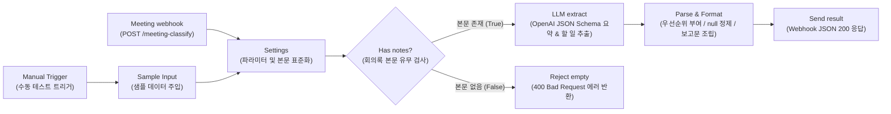

# 66-agy: 회의록 분석 및 할 일/보고서 생성 n8n 워크플로우

회의록 텍스트(`notes`)를 웹훅으로 수신하여 OpenAI LLM으로 **2문장 요약(`summary`)**, **담당자/기한 미정 항목을 포함한 할 일 목록(`actions`: null 처리 및 priority 판별)**, **공유용 정리문(`report_text`)**을 생성하여 구조화된 JSON으로 반환하는 n8n 시나리오입니다.

---

## 1. 워크플로우 처리 흐름 (Flowchart)



---

## 2. 노드별 역할 및 파이프라인 명세

| 단계 | 노드명 | 노드 유형 | 입력 (Input) | 출력 (Output) 및 핵심 처리 로직 |
| :---: | :--- | :---: | :--- | :--- |
| **1** | **Meeting webhook** | `webhook` | HTTP POST Body | `path: meeting-classify`, `responseMode: responseNode`<br/>클라이언트 요청의 `title`, `notes`를 수신 |
| **1-ALT** | **Manual & Sample** | `manualTrigger` + `set` | 수동 실행 버튼 클릭 | 테스트용 주간 회의 샘플 데이터 주입 (n8n 내부 단독 테스트용) |
| **2** | **Settings** | `set` | 웹훅 본문 또는 샘플 데이터 | `llm_url`(`https://api.openai.com/v1`), `model`(`gpt-4.1-mini`), `title`, `notes` 필드 표준화 |
| **3** | **Has notes?** | `if` | `notes` 문자열 | 회의록 본문 존재 여부 검증 (`notEmpty`). 비어있으면 False 분기로 라우팅 |
| **4-ERR** | **Reject empty** | `respondToWebhook` | 빈 본문 요청 | HTTP 400 상태코드 및 `{"error": "notes is required"}` 응답 즉시 반환 |
| **4** | **LLM extract** | `httpRequest` | OpenAI API 요청 | `response_format: json_schema`를 통해 회의 요약, 업무 목록(담당자/기한 미정 포함), 다음 회의 일정을 구조화된 JSON으로 추출 |
| **5** | **Parse & Format** | `code` | LLM JSON 응답 | • 담당자/기한 미정 항목은 `null`로 정제<br/>• 당일/긴급 업무는 `priority: "높음"`, 그 외 `priority: "보통"` 부여<br/>• `count` 계산 및 `route` 결정 (`할 일 정리` 또는 `할 일 없음`)<br/>• 번호가 붙은 공유용 `report_text` 문자열 조립 |
| **6** | **Send result** | `respondToWebhook` | 최종 가공 JSON | 호출자에게 HTTP 200 상태코드 및 최종 명세 규격 JSON 반환 |

---

## 3. LLM 프롬프트 및 JSON 스키마 설계

### 3.1. Structured Outputs 스키마 (`meeting_analysis`)

OpenAI Chat API의 `strict: true` JSON Schema를 적용하여 출력 형태를 엄격히 보장합니다.

```json
{
  "name": "meeting_analysis",
  "strict": true,
  "schema": {
    "type": "object",
    "properties": {
      "summary": {
        "type": "string",
        "description": "회의 주요 안건 및 결정 사항을 한국어 1~2문장으로 요약"
      },
      "actions": {
        "type": "array",
        "description": "회의에서 도출된 모든 업무 목록 (담당자나 기한 미정인 업무도 빠짐없이 포함)",
        "items": {
          "type": "object",
          "properties": {
            "task": {
              "type": "string",
              "description": "업무 내용 (한국어 개조식 문장)"
            },
            "owner": {
              "type": ["string", "null"],
              "description": "담당자 이름. 지정되지 않았거나 추후 결정 예정이면 null"
            },
            "due": {
              "type": ["string", "null"],
              "description": "업무 기한 (예: 금요일, 오늘 중, 다음 주 월요일). 기한이 없거나 미정이면 null. 다음 회의 일정은 업무 기한이 아니므로 절대 due로 넣지 말 것"
            }
          },
          "required": ["task", "owner", "due"],
          "additionalProperties": false
        }
      },
      "next_meeting": {
        "type": ["string", "null"],
        "description": "다음 회의 일정(예: 10월 23일) 또는 null"
      }
    },
    "required": ["summary", "actions", "next_meeting"],
    "additionalProperties": false
  }
}
```

### 3.2. 시스템 프롬프트 (System Prompt)

```text
당신은 회의록 분석 전문 어시스턴트입니다. 회의록에서 요약과 업무 목록(Action Items)을 추출하여 지정된 JSON 스키마로 답변하세요.
1. summary: 회의 핵심 내용을 한국어 1~2문장으로 간결하게 작성하세요.
2. actions: 실행 가능한 모든 업무 목록을 작성하세요.
   - 담당자나 기한이 정해지지 않은 업무도 누락 없이 반드시 포함하세요.
   - owner: 담당자 이름. 담당자가 없거나 다음 회의 등에서 정하기로 한 경우 반드시 null로 설정하세요.
   - due: 업무 마감 기한 (예: "금요일", "다음 주 월요일", "오늘 중"). 마감 기한이 명시되지 않은 경우 반드시 null로 설정하세요.
   - 주의: "다음 회의는 10월 23일"과 같은 차기 회의 일정은 업무 기한(due)이 아니므로 업무 due로 넣지 마세요.
3. next_meeting: 다음 회의 날짜/일정이 있으면 기록하고, 없으면 null로 설정하세요.
```

---

## 4. 입출력 데이터 명세 및 검증 기준

### 4.1. 테스트 입력 (Input)

```json
{
  "title": "10월 16일 주간 회의",
  "notes": "참석: 김민지, 이준호, 박서연. 1) 신규 고객 문의 응답 템플릿을 이준호가 금요일까지 정리한다. 2) 박서연은 다음 주 월요일까지 VPN 장애 보고서를 작성한다. 3) 서버 점검 일정은 김민지가 오늘 중 공지한다. 4) 회의실 예약 규칙 개선은 담당자를 다음 회의에서 정한다. 다음 회의는 10월 23일."
}
```

### 4.2. 예상 반환 JSON 응답 (Output)

```json
{
  "title": "10월 16일 주간 회의",
  "route": "할 일 정리",
  "count": 4,
  "summary": "신규 고객 문의 템플릿 정리, VPN 장애 보고서 작성, 서버 점검 공지 등 주요 업무 일정을 확인했습니다. 회의실 예약 규칙 개선 담당자는 차기 회의에서 지정하기로 했습니다.",
  "actions": [
    {
      "task": "신규 고객 문의 응답 템플릿 정리",
      "owner": "이준호",
      "due": "금요일",
      "priority": "보통"
    },
    {
      "task": "VPN 장애 보고서 작성",
      "owner": "박서연",
      "due": "다음 주 월요일",
      "priority": "보통"
    },
    {
      "task": "서버 점검 일정 공지",
      "owner": "김민지",
      "due": "오늘 중",
      "priority": "높음"
    },
    {
      "task": "회의실 예약 규칙 개선",
      "owner": null,
      "due": null,
      "priority": "보통"
    }
  ],
  "report_text": "10월 16일 주간 회의\n신규 고객 문의 템플릿 정리, VPN 장애 보고서 작성, 서버 점검 공지 등 주요 업무 일정을 확인했습니다. 회의실 예약 규칙 개선 담당자는 차기 회의에서 지정하기로 했습니다.\n\n[할 일 목록]\n1. [보통] 신규 고객 문의 응답 템플릿 정리 - 이준호 (금요일)\n2. [보통] VPN 장애 보고서 작성 - 박서연 (다음 주 월요일)\n3. [높음] 서버 점검 일정 공지 - 김민지 (오늘 중)\n4. [보통] 회의실 예약 규칙 개선 - 담당자 미정 (기한 미정)"
}
```

### 4.3. 검증 기준 체크리스트

| 검증 항목 | 기준 | 통과 여부 확인 방법 |
| :--- | :--- | :--- |
| **업무 총 개수** | `count: 4` 및 `actions` 배열 항목 4개 | 담당자 미정 항목(회의실 예약 규칙 개선)이 누락되지 않고 포함됨 |
| **미정 항목 null 처리** | 4번째 업무의 `owner: null`, `due: null` | 문자열 `"미정"`이 아닌 JSON 리터럴 `null`로 정확히 반환 |
| **긴급/당일 우선순위** | 3번째 업무(서버 점검 일정) `priority: "높음"` | "오늘 중" 기한에 따라 `"높음"` 판별, 나머지는 `"보통"` 판별 |
| **차기 회의 분리** | 4번째 업무의 `due`가 `null` | `"10월 23일"`(다음 회의 날짜)이 업무 기한으로 잘못 매핑되지 않음 |
| **보고서 필드** | `summary` 및 `report_text` 포함 | 제목 + 요약 + 번호 매겨진 할 일 목록 조립, null은 "담당자 미정", "기한 미정" 표기 |
| **라우팅 필드** | `route: "할 일 정리"` | 할 일 항목이 존재하므로 동적으로 `"할 일 정리"` 설정 |

---

## 5. n8n 워크플로우 설정 및 배포 가이드

### Step 1: n8n에 워크플로우 가져오기 (Import)
1. 웹 브라우저에서 n8n 대시보드(`http://localhost:5678`)에 접속합니다.
2. 좌측 메뉴에서 **Workflows**로 이동합니다.
3. 우측 상단의 `+ Add workflow` 옆의 **`...` (More actions)** 아이콘을 클릭하고 **`Import from File`**을 선택합니다.
4. 파일 선택 창에서 다음 파일을 지정하여 불러옵니다:
   - 파일 경로: `C:\aio-01d4-stu\Last3Mon\66\n8n\myworkflows\66-agy.json` (WSL: `/mnt/c/aio-01d4-stu/Last3Mon/66/n8n/myworkflows/66-agy.json`)

### Step 2: OpenAI Credential 설정
1. 워크플로우 캔버스에서 **`LLM extract`** 노드를 더블 클릭합니다.
2. **Credential to connect with** 항목에서 기등록된 OpenAI 인증 정보(`OpenAI (.env)` 또는 `openAiCourse0001`)를 선택합니다.
3. 등록된 인증 정보가 없는 경우, **Create New Credential**을 선택하여 유효한 OpenAI API Key를 입력하고 저장합니다.

### Step 3: 워크플로우 활성화 및 Publish
1. 캔버스 우측 상단의 **`Save`** 버튼(단축키: `Ctrl + S`)을 눌러 변경 사항을 저장합니다.
2. 우측 상단의 토글 스위치를 전환하여 **`Active`** (또는 **`Publish`**) 상태로 변경합니다.
3. 이제 Production Webhook URL(`http://localhost:5678/webhook/meeting-classify`)로 들어오는 외부 요청을 상시 처리할 수 있습니다.

---

## 6. 테스트 방법 및 curl / jq 실행 가이드

### 6.1. Test Webhook vs Production Webhook 차이점

| 구분 | 엔드포인트 URL | 특징 및 테스트 방법 |
| :--- | :--- | :--- |
| **Test URL** | `http://localhost:5678/webhook-test/meeting-classify` | • n8n 편집기에서 **`Listen for test event`** (또는 Webhook 노드의 `Test step`) 버튼을 누른 후 1회 수신 대기 상태일 때만 동작합니다.<br/>• 각 노드의 실행 데이터와 단계별 입출력을 UI에서 즉시 디버깅할 수 있습니다. |
| **Production URL** | `http://localhost:5678/webhook/meeting-classify` | • 워크플로우가 **`Active: On`** (Publish) 상태일 때 백그라운드에서 상시 대기합니다.<br/>• 실제 서비스나 자동화 파이프라인에서 지속적으로 호출할 때 사용합니다. |

---

### 6.2. WSL에서 바로 실행 가능한 cURL 명령어

#### A. Test Webhook 테스트 (n8n에서 Listen for test event 클릭 후 실행)
```bash
curl -X POST http://localhost:5678/webhook-test/meeting-classify \
  -H "Content-Type: application/json" \
  -d '{
    "title": "10월 16일 주간 회의",
    "notes": "참석: 김민지, 이준호, 박서연. 1) 신규 고객 문의 응답 템플릿을 이준호가 금요일까지 정리한다. 2) 박서연은 다음 주 월요일까지 VPN 장애 보고서를 작성한다. 3) 서버 점검 일정은 김민지가 오늘 중 공지한다. 4) 회의실 예약 규칙 개선은 담당자를 다음 회의에서 정한다. 다음 회의는 10월 23일."
  }'
```

#### B. Production Webhook 테스트 (워크플로우 Active 상태에서 상시 실행 가능)
```bash
curl -X POST http://localhost:5678/webhook/meeting-classify \
  -H "Content-Type: application/json" \
  -d '{
    "title": "10월 16일 주간 회의",
    "notes": "참석: 김민지, 이준호, 박서연. 1) 신규 고객 문의 응답 템플릿을 이준호가 금요일까지 정리한다. 2) 박서연은 다음 주 월요일까지 VPN 장애 보고서를 작성한다. 3) 서버 점검 일정은 김민지가 오늘 중 공지한다. 4) 회의실 예약 규칙 개선은 담당자를 다음 회의에서 정한다. 다음 회의는 10월 23일."
  }'
```

#### C. 빈 본문 요청 테스트 (400 Bad Request 검증)
```bash
curl -i -X POST http://localhost:5678/webhook/meeting-classify \
  -H "Content-Type: application/json" \
  -d '{"title": "빈 회의록", "notes": ""}'
```

---

### 6.3. jq를 이용한 JSON 출력 정렬 및 검증 방법

#### 1) 전체 응답 예쁘게 출력 및 키 알파벳 순 정렬 (`-S`)
```bash
curl -s -X POST http://localhost:5678/webhook/meeting-classify \
  -H "Content-Type: application/json" \
  -d '{
    "title": "10월 16일 주간 회의",
    "notes": "참석: 김민지, 이준호, 박서연. 1) 신규 고객 문의 응답 템플릿을 이준호가 금요일까지 정리한다. 2) 박서연은 다음 주 월요일까지 VPN 장애 보고서를 작성한다. 3) 서버 점검 일정은 김민지가 오늘 중 공지한다. 4) 회의실 예약 규칙 개선은 담당자를 다음 회의에서 정한다. 다음 회의는 10월 23일."
  }' | jq -S .
```

#### 2) 핵심 요약 정보만 선별 조회 (`title`, `route`, `count`)
```bash
curl -s -X POST http://localhost:5678/webhook/meeting-classify \
  -H "Content-Type: application/json" \
  -d '{
    "title": "10월 16일 주간 회의",
    "notes": "참석: 김민지, 이준호, 박서연. 1) 신규 고객 문의 응답 템플릿을 이준호가 금요일까지 정리한다. 2) 박서연은 다음 주 월요일까지 VPN 장애 보고서를 작성한다. 3) 서버 점검 일정은 김민지가 오늘 중 공지한다. 4) 회의실 예약 규칙 개선은 담당자를 다음 회의에서 정한다. 다음 회의는 10월 23일."
  }' | jq '{title, route, count, summary}'
```

#### 3) `actions` 목록의 담당자, 기한, 우선순위 확인 (null 처리 및 priority 검증)
```bash
curl -s -X POST http://localhost:5678/webhook/meeting-classify \
  -H "Content-Type: application/json" \
  -d '{
    "title": "10월 16일 주간 회의",
    "notes": "참석: 김민지, 이준호, 박서연. 1) 신규 고객 문의 응답 템플릿을 이준호가 금요일까지 정리한다. 2) 박서연은 다음 주 월요일까지 VPN 장애 보고서를 작성한다. 3) 서버 점검 일정은 김민지가 오늘 중 공지한다. 4) 회의실 예약 규칙 개선은 담당자를 다음 회의에서 정한다. 다음 회의는 10월 23일."
  }' | jq '.actions[] | {task, owner, due, priority}'
```

#### 4) `report_text`의 줄바꿈 서식 그대로 읽기 (`-r`)
```bash
curl -s -X POST http://localhost:5678/webhook/meeting-classify \
  -H "Content-Type: application/json" \
  -d '{
    "title": "10월 16일 주간 회의",
    "notes": "참석: 김민지, 이준호, 박서연. 1) 신규 고객 문의 응답 템플릿을 이준호가 금요일까지 정리한다. 2) 박서연은 다음 주 월요일까지 VPN 장애 보고서를 작성한다. 3) 서버 점검 일정은 김민지가 오늘 중 공지한다. 4) 회의실 예약 규칙 개선은 담당자를 다음 회의에서 정한다. 다음 회의는 10월 23일."
  }' | jq -r .report_text
```
