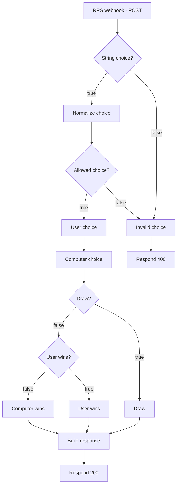

# Code 노드 없는 가위바위보 n8n 워크플로

`POST` 요청의 JSON 본문에 `choice`를 보내면 컴퓨터가 무작위로 선택하고 승패를 JSON으로 반환합니다. Code·Function 노드, 외부 API, 인증 정보, 추가 패키지를 사용하지 않습니다. Edit Fields(Set)의 짧은 n8n 표현식은 사용합니다.

## 파일

- `rock-paper-scissors.workflow.json`: 가져오기용 워크플로. `active: false`.
- `rock-paper-scissors.workflow.test.cjs`: 실제 JSON의 필드 설정·표현식·IF 조건·연결을 읽는 회귀 테스트.
- `rock-paper-scissors.workflow.md`: 이 설명서.

기존 `rock-paper-scissors.test.cjs`, `rock-paper-scissors.md`는 위 이름으로 변경했습니다.

## 구성

n8n 2.42.6의 설치된 정의를 확인했습니다. 총 15개 노드이며 Webhook v2, Edit Fields(Set) v3.4, IF v2.2, Respond to Webhook v1.1을 사용합니다.



| 단계 | 설정과 동작 |
| --- | --- |
| RPS webhook | POST, path `rock-paper-scissors`, 응답 모드 `responseNode` |
| String choice? | 본문이 null·배열이 아닌 객체이고 자체 `choice` 필드가 문자열인지 검사. 문자열 메서드는 이 검사 뒤에 실행 |
| Normalize choice | `choice.trim().toUpperCase()`로 정규화. 다른 요청 필드는 제거 |
| Allowed choice? | 바위·보·가위·R·P·S 목록에 정확히 포함되는지 검사 |
| User choice | R·P·S를 바위·보·가위로 변환. `userChoice`만 출력 |
| Computer choice | 컴퓨터 선택을 한 번 생성하고 저장. `userChoice` 유지 |
| Draw? | 사용자와 컴퓨터 선택의 동일 여부로 분기 |
| User wins? | 바위/가위, 보/바위, 가위/보 세 조합 중 하나인지 분기 |
| Draw / User wins / Computer wins | 기존 선택을 유지하며 `result` 지정 |
| Build response | `ok`, `userChoice`, `computerChoice`, `result`, `message`만 출력 |
| Invalid choice | 고정된 오류 JSON 생성. 원문을 포함하지 않음 |
| Respond 200 / Respond 400 | `$json`을 JSON으로 반환. 각각 HTTP 200 / 400 |

모든 IF는 엄격한 boolean 검사와 true·false 연결을 사용합니다. 정상 경로와 오류 경로는 각각 응답 노드 하나에서 끝납니다. 오류 경로는 컴퓨터 선택을 실행하지 않습니다.

## 입력과 판정

허용 입력은 바위·보·가위와 R·P·S입니다. 영문 소문자, 앞뒤 공백·탭·개행도 허용합니다. 예를 들어 `" p "`는 보가 됩니다. 누락·빈 문자열·잘못된 문자열·숫자·boolean·null·배열·객체는 HTTP 400입니다. `constructor`, `__proto__` 등도 허용하지 않습니다.

본문의 `choice`만 사용하므로 query string 또는 추가 필드 `computerChoice`, `result`, `valid` 등으로 결과를 지정할 수 없습니다. 깨진 JSON은 워크플로 실행 전에 n8n HTTP 파서가 거절할 수 있습니다.

컴퓨터 선택 표현식:

```javascript
{{ ['바위', '보', '가위'][Math.floor(Math.random() * 3)] }}
```

이 표현식은 Computer choice 노드에서 한 번 평가하고 저장합니다. 후속 노드는 저장된 값만 읽습니다. `[0, 1/3)`, `[1/3, 2/3)`, `[2/3, 1)` 구간에 각각 바위·보·가위를 대응시킵니다. 유한 표본으로 난수의 균등성을 증명하는 테스트는 아닙니다.

| 사용자 / 컴퓨터 | 바위 | 보 | 가위 |
| --- | --- | --- | --- |
| 바위 | 무승부 | 컴퓨터 승리 | 사용자 승리 |
| 보 | 사용자 승리 | 무승부 | 컴퓨터 승리 |
| 가위 | 컴퓨터 승리 | 사용자 승리 | 무승부 |

## 가져오기와 실행

1. n8n에서 Import from File로 `rock-paper-scissors.workflow.json`을 가져옵니다.
2. 15개 노드와 정상·오류 분기를 확인합니다. 기존에 동일한 Webhook 경로를 사용한다면 path를 변경합니다.
3. RPS webhook에서 **Listen for test event**를 누릅니다.
4. 에디터에 표시된 Test URL로 요청합니다. 다음 요청 전에는 테스트 이벤트 대기를 다시 시작합니다.

로컬 n8n이 5678 포트로 제공되는 경우의 Bash 예시입니다. 실제 에디터의 URL을 우선하세요.

```bash
curl -i -X POST 'http://localhost:5678/webhook-test/rock-paper-scissors' \
  -H 'Content-Type: application/json' --data '{"choice":" p "}'

# 테스트 대기를 다시 시작한 후 오류 확인
curl -i -X POST 'http://localhost:5678/webhook-test/rock-paper-scissors' \
  -H 'Content-Type: application/json' --data '{"choice":null}'
```

정상 응답 예시(컴퓨터 선택은 매번 달라질 수 있음):

```json
{"ok":true,"userChoice":"보","computerChoice":"바위","result":"사용자 승리","message":"사용자: 보, 컴퓨터: 바위 — 사용자 승리!"}
```

오류 응답:

```json
{"ok":false,"error":"INVALID_CHOICE","message":"바위, 보, 가위 또는 R, P, S 중 하나를 입력하세요."}
```

운영 URL은 게시 후 `/webhook/rock-paper-scissors`를 사용합니다. 파일은 비활성 상태이며 이번 수정에서는 기존 운영 인스턴스에 가져오거나 게시하지 않았습니다.

## 회귀 테스트

```bash
cd /mnt/c/aio-01d4-stu/Last3Mon/66/n8n/myworkflows
node rock-paper-scissors.workflow.test.cjs
```

호스트에 Node.js가 없다면 기존 로컬 n8n 이미지로 실행할 수 있습니다.

```bash
docker run --rm --pull=never --network none --read-only \
  --mount type=bind,source=/mnt/c/aio-01d4-stu/Last3Mon/66/n8n/myworkflows,target=/input,readonly \
  --entrypoint node n8nio/n8n:2.42.6 /input/rock-paper-scissors.workflow.test.cjs
```

테스트는 JSON의 실제 Set 설정을 입력 아이템 기준으로 평가하고, IF 조건과 연결을 따라 이동합니다. n8n 엔진 전체를 재현하는 테스트는 아니므로 실제 엔진 검증과 구분합니다. 승패 로직을 테스트에 복사하지 않고 전체 9조합의 고정 기대 결과와 비교합니다.

2026-10-16 검증 결과:

- 회귀 테스트 67개 통과: 그래프·지원 노드·ID 고유성, 승패 9조합, 정규화 15건, 오류 입력 34건, 난수 경계값 7건, 추가 필드 무시 1건.
- 각 경로의 응답 종착점 1개, 정상 경로 난수 호출 1회, 오류 경로 0회를 확인했습니다.
- Code·Function·Function Item 노드와 `jsCode` 속성이 없는지 검사했습니다.

입력 필드의 자체 소유 여부는 `Object.keys($json.body).includes('choice')`로 확인합니다. n8n 표현식 보안 제한이 `Object.prototype` 접근을 차단하므로 해당 접근을 사용하지 않습니다.

실제 실행 검증은 기존 `n8nio/n8n:2.42.6` 이미지에 입력 파일을 읽기 전용으로 마운트하고, `--network none`, 임시 `/tmp` DB, 호스트 포트 미공개 상태에서 수행합니다. 컨테이너 안의 HTTP 클라이언트만 컨테이너 안의 n8n에 접속합니다. 이 환경의 게시·활성화는 검증용이며 기존 서비스 DB·볼륨에는 접근하지 않습니다.

브라우저의 에디터 조작, 외부 프록시 URL, 다른 n8n 버전은 검증 범위에 포함하지 않습니다. 실제 HTTP 검증의 무작위 결과와 달리, 전체 9조합 및 난수 경계값은 회귀 테스트에서 난수를 제어해 확인합니다.

최종 실제 n8n 검증도 통과했습니다.

| 검증 | 결과 |
| --- | --- |
| 비활성 파일 가져오기·재내보내기 | 워크플로 1개, `active: false`, 15개 노드와 연결 원본 일치 |
| 실제 Webhook 정상 요청 | 6건 HTTP 200, 정규화·컴퓨터 선택·판정·응답 필드와 메시지 일치 |
| 실제 Webhook 오류 요청 | 13건 HTTP 400, 고정 오류 JSON 일치 |
| 최종 표현식으로 회귀 테스트 재실행 | 67개 통과 |

HTTP 검증 준비 중에는 시작 직후 Webhook 미등록으로 404가 발생했습니다. 준비 대기 후 등록된 Webhook으로 검증했습니다. 첫 실제 표현식 실행에서 `Object.prototype` 접근 제한으로 500이 발생했고, 이를 `Object.keys()` 방식으로 수정한 최종 파일이 위 검증을 통과했습니다. 검증용 임시 DB에서는 CLI 게시 후 활성 상태를 명시적으로 확인·설정했습니다. 배포 파일 자체는 계속 비활성입니다.
