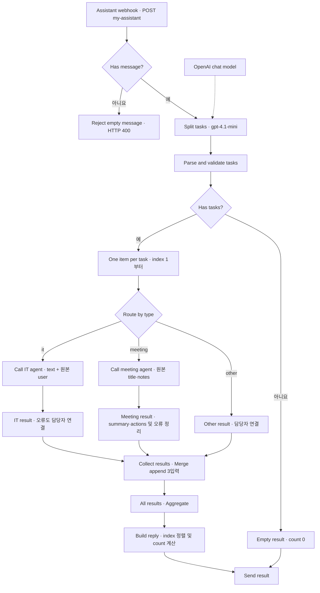

# Multi-Agent 설계서 · 사내 업무 도우미

- 이름:
- 사용한 CLI 에이전트: codex / claude / agy
- 이 파일을 `my-work/DESIGN.md`로 복사해 채웁니다.

## 1. 업무 분석표 (Lab 01 예제 1)

| 요청 | 업무 | 유형 (it · meeting · other) | 필요한 입력 | 요청에 있나 | 업무 관계 (독립 · 순서) |
| --- | --- | --- | --- | --- | --- |
| `composite` | ① T-1002 처리 상태 확인<br>② 회의록 할 일 정리<br>③ 프린터 출력 안 됨 | ① it<br>② meeting<br>③ it | ① 접수 번호, 요청한 사람 (`user`)<br>② 회의록 원문 (`notes`)<br>③ 증상, 요청한 사람 (`user`) | 모두 있음: 접수 번호·증상은 `message`, 요청한 사람은 `user`, 회의록 원문은 `notes` | 셋 다 독립 |
| `two-it` | ① 비밀번호 분실<br>② 메일함 용량 부족 | ① it<br>② it | 각각 증상, 요청한 사람 (`user`) | 모두 있음 (`message`, `user`) | 독립 (같은 Agent에 별도 업무로 전달) |
| `it-and-other` | ① 프린터 출력 안 됨<br>② 회식 장소 추천 | ① it<br>② other | ① 증상, 요청한 사람 (`user`)<br>② 추천 조건 (지역·인원·예산 등, 담당 Agent의 입력 계약 없음) | ① 있음 (`message`, `user`)<br>② 다음 주 회식이라는 목적은 있으나 지역·인원·예산 등은 없음 | 둘 다 독립 |
| `meeting-no-notes` | ① 회의록 할 일 정리 | meeting | 회의록 원문 (`notes`) | 없음 (`notes` 누락) | — (단일 업무) |
| 내 업무에서 하나 |  |  |  |  |  |

## 2. Agent 목록과 계약 (Lab 02 예제 1)

> 확인 범위: 워크플로우 파일 기준. 실제 호출 출력은 제공되지 않아 실행 결과와의 비교는 미확인입니다.

### Agent 개요

| Agent | 맡는 업무 | 웹훅 |
| --- | --- | --- |
| IT 문의 (`it-agent`) | FAQ 기반 IT 문의 답변, 요청자 본인의 접수 상태 조회 | `POST /webhook/it-agent` |
| 회의록 (`meeting-agent`) | 회의록 요약, 담당자·업무·기한이 있는 할 일 추출 | `POST /webhook/meeting-agent` |

### 입력 계약

모든 입력은 JSON 요청 본문에서 읽습니다.

| Agent | 필드 | 필수 여부 | 내용·처리 |
| --- | --- | --- | --- |
| IT 문의 | `question` | 필수 | IT 질문 또는 접수 번호를 포함한 질문 문자열 |
| IT 문의 | `user` | 필수 | 실제 요청자 문자열. 질문 속 이름으로 대체하지 않음 |
| 회의록 | `notes` | 필수 | 회의록 원문 문자열 |
| 회의록 | `title` | 선택 | 회의 제목. 응답에서는 문자열 변환·trim 후 비면 `"회의"` |

- IT 문의는 `Has question?` → `Has user?` 순서로 검사하며, 별도 선택 입력은 없습니다.
- 회의록은 `Has notes?`에서 검사하고 `user`는 사용하지 않습니다.
- 필수 입력 검사는 strict 문자열 `notEmpty`이며 `trim()`은 하지 않습니다. 공백을 제거해 검사하는 라우터 규칙과 구분해야 합니다.
- 잘못된 자료형에 대한 별도 HTTP 400 응답은 정의되어 있지 않습니다.

### IT 문의 응답

| 경로 | HTTP | 결과 필드와 구조 |
| --- | --- | --- |
| 자동 답변 | 200 | `route: "자동 답변"`, `answer: string`, `tools_used: string[]`, `sources: string[]` |
| 답변 검증 실패 | 200 | `route: "담당자 연결"`, `answer: string`, `draft: string`, `tools_used: string[]`, `failed: string[]` |
| 질문 검사 실패 | 400 | `{"error":"question is required"}` |
| 질문 통과 후 요청자 검사 실패 | 400 | `{"error":"user is required"}` |

| 필드 | 의미 |
| --- | --- |
| `answer` | 자동 답변 내용. 담당자 연결 시에는 `"정확한 답을 찾지 못해 IT 담당자에게 문의를 전달했습니다."` |
| `tools_used` | 중복을 제거한 Tool 이름 배열. 예: `Search_FAQ`, `Get_ticket` |
| `sources` | Tool 관측 결과에서 추출한 `FAQ-숫자3자리`·`T-숫자4자리` 식별자 배열. 자동 답변 경로에만 포함 |
| `draft` | 검증을 통과하지 못한 LLM 답변 초안. 담당자 연결 경로에만 포함 |
| `failed` | 실패한 검증 항목 이름 배열. 담당자 연결 경로에만 포함 |

`Check answer`는 다음 조건을 검사합니다.

- 답변이 비어 있지 않음
- Tool이 유효한 데이터를 찾음
- 접수 번호가 있는 질문에서 `Get_ticket`을 사용함
- 답변에 한국어가 포함됨
- 답변이 400자 이하임

타인 접수의 `not your ticket`은 유효 데이터로 인정하지 않으며, LLM에는 상세 공개 금지가 지시되어 있습니다. 실제 비공개 준수 여부는 호출 결과로 추가 확인해야 합니다. “문의 전달”은 응답 문구이며, 별도의 실제 접수·전달 노드는 없습니다.

### 회의록 응답

| 필드 | 자료형·구조 | 처리 규칙 |
| --- | --- | --- |
| `route` | string | actions가 있으면 `"자동 답변"`, 없으면 `"담당자 연결"` |
| `title` | string | 요청 제목을 문자열 변환·trim 후 비면 `"회의"` |
| `count` | number | 빈 task를 제거한 `actions` 길이 |
| `summary` | string | 요약. 없으면 빈 문자열 |
| `actions` | `{owner: string, task: string, due: string}[]` | owner·due가 없거나 falsy면 `"미정"`. task는 문자열 변환·trim 후 비면 제거 |

| 경로 | HTTP | 응답 |
| --- | --- | --- |
| 정상 처리 | 200 | 위 여섯 필드 반환 |
| notes 검사 실패 | 400 | `{"error":"notes are required"}` |
| LLM JSON 파싱 실패 | 200 | `route: "담당자 연결"`, `title: 요청 제목 또는 "회의"`, `count: 0`, `summary: ""`, `actions: []` |

`actions`가 배열이 아니면 빈 배열로 처리합니다. 이때 `summary`는 파싱 결과에 따라 유지될 수 있습니다. JSON 파싱 오류는 catch하지만 모든 비정상 구조를 검증하지는 않습니다. 예를 들어 결과가 `null`이거나 actions에 `null`이 있으면 속성 접근 오류가 발생할 수 있습니다.

### 확인 근거와 실제 호출 비교

| 구분 | 확인 내용 |
| --- | --- |
| 파일로 확인 | 위 입력 검사, 응답 필드, 분기 및 오류 처리 |
| 호출로 확인 | 없음. 제공된 내용은 `[지금 받은 터미널 출력 전체를 여기에 붙여 넣기]`라는 자리표시자뿐임 |
| 파일·호출 차이 | 실제 HTTP 응답이 없어 일치 여부와 차이 모두 미확인 |

HTTP 200은 `Send result`의 응답 코드 미지정에 따른 기본값이며, HTTP 400은 각 Reject 노드의 명시 설정입니다. 두 Agent 모두 LLM·네트워크 등 실행 오류 전체를 고정 HTTP 상태·본문으로 변환하는 공통 오류 경로는 없습니다. 위 실패 응답은 파일에 명시된 경로에 한정됩니다.

| 파일 | 확인한 노드 및 연결 |
| --- | --- |
| [it-agent.json](../agents/it-agent.json) | `IT question webhook`, `Has question?`, `Has user?`, `Reject empty`, `Reject no user`, `Check answer`, `Passed?`, `Auto answer`, `Hand off`, `Send result` |
| [meeting-agent.json](../agents/meeting-agent.json) | `Meeting webhook`, `Has notes?`, `Reject empty`, `Build report`, `Send result` |

## 3. 흐름도 (mermaid)



업무 항목의 `index`, `type`, `text`는 HTTP 응답과 연결된 원래 항목에서 복원합니다. 같은 유형의 모든 업무를 처리하고, 실행되지 않은 유형의 갈래가 있어도 모인 결과를 반환합니다. HTTP 호출은 `neverError: true`와 전체 응답을 사용하며, HTTP 오류·연결 실패·잘못된 응답 구조는 해당 업무의 담당자 연결 결과로 정리합니다.

## 4. 통합 응답 형식

다음은 응답 구조를 설명하기 위한 예시이며 실제 호출 결과가 아닙니다.

```json
{
  "count": 3,
  "results": [
    {
      "index": 1,
      "type": "it",
      "text": "T-1002 처리 상태 확인",
      "agent": "it-agent",
      "route": "자동 답변",
      "answer": "T-1002는 처리 중입니다."
    },
    {
      "index": 2,
      "type": "meeting",
      "text": "회의록 할 일 정리",
      "agent": "meeting-agent",
      "route": "자동 답변",
      "answer": "회의 할 일을 정리했습니다.\n- 담당자: 이준호 / 할 일: 자료 정리 / 기한: 금요일",
      "actions": [
        {
          "owner": "이준호",
          "task": "자료 정리",
          "due": "금요일"
        }
      ]
    },
    {
      "index": 3,
      "type": "it",
      "text": "프린터 출력 문제 문의",
      "agent": "it-agent",
      "route": "자동 답변",
      "answer": "프린터 전원과 대기열을 확인하세요."
    }
  ],
  "reply": "1. T-1002 처리 상태 확인\nT-1002는 처리 중입니다.\n\n2. 회의록 할 일 정리\n회의 할 일을 정리했습니다.\n- 담당자: 이준호 / 할 일: 자료 정리 / 기한: 금요일\n\n3. 프린터 출력 문제 문의\n프린터 전원과 대기열을 확인하세요."
}
```

- `results`는 `index` 오름차순이며 `count`는 정렬된 결과의 길이입니다.
- 회의록 결과에는 `actions`를 보존하고, `answer`에 요약과 각 담당자·할 일·기한을 표시합니다.
- `other`는 `agent`·`route` 모두 `"담당자 연결"`, `answer`는 `"현재 지원하지 않는 업무이므로 담당자에게 연결합니다."`입니다.
- `reply`는 정렬된 각 업무의 번호·text·answer를 빈 줄로 연결합니다.
- 분할 결과 파싱·검증 실패 또는 빈 업무 목록은 `{"count": 0, "results": [], "reply": ""}`를 반환합니다.
- 빈 message는 LLM 호출 전에 HTTP 400 `{"error":"message is required"}`로 응답합니다.

## 5. 예외 경로 (Lab 03)

| 상황 | 라우터가 할 일 | 확인한 테스트 |
| --- | --- | --- |
| 필요한 입력이 없음 | `Parse and validate tasks`에서 원본 `Assistant webhook.body`의 it → `user`, meeting → `notes`를 검사. 필드 없음·null·공백 문자열은 `missing`에 기록. `Has missing input?`에서 호출을 건너뛰고 `Input needed result`로 `route: "입력 필요"` 반환. notes: `"회의록 원문(notes)을 보내 주세요."`, user: `"요청한 사람(user)을 보내 주세요."`. index·type·text·agent를 보존하고 다른 업무와 함께 수집·정렬하여 results·count에 포함. title은 필수 검사하지 않음. | 수정 전 보고서 `runs/lab03-20261020-144651.json`: 회의록 없는 회의 요청 실패(담당자 연결 반환), 나머지 4개 통과. 이번 수정은 check만 확인하며 Lab 03·Lab 02 실제 재검증 전이므로 통과 여부 미확인. |
| 담당 Agent가 꺼짐 |  |  |
| 맡을 Agent가 없는 업무 |  |  |

## 6. 확장 계획 (Lab 03 과제, 측정값으로)

| 측정 | 값 (`runs/` 보고서) |
| --- | --- |
| IT 하나 |  초 |
| 회의록 하나 |  초 |
| 복합 요청 (업무 3개) |  초 |

- 직원 21명이 동시에 복합 요청을 보내면 어디가 먼저 막히나?
- 수직 확장(더 큰 서버)과 수평 확장(n8n 작업자 여러 개, Agent별 분리) 중 무엇을 먼저 하나? 이유는?
