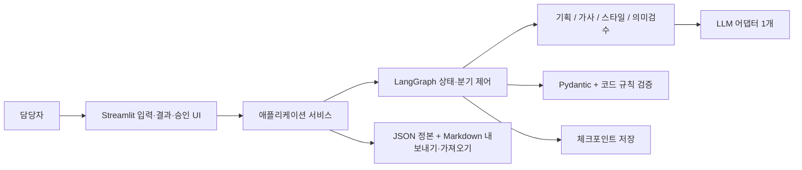
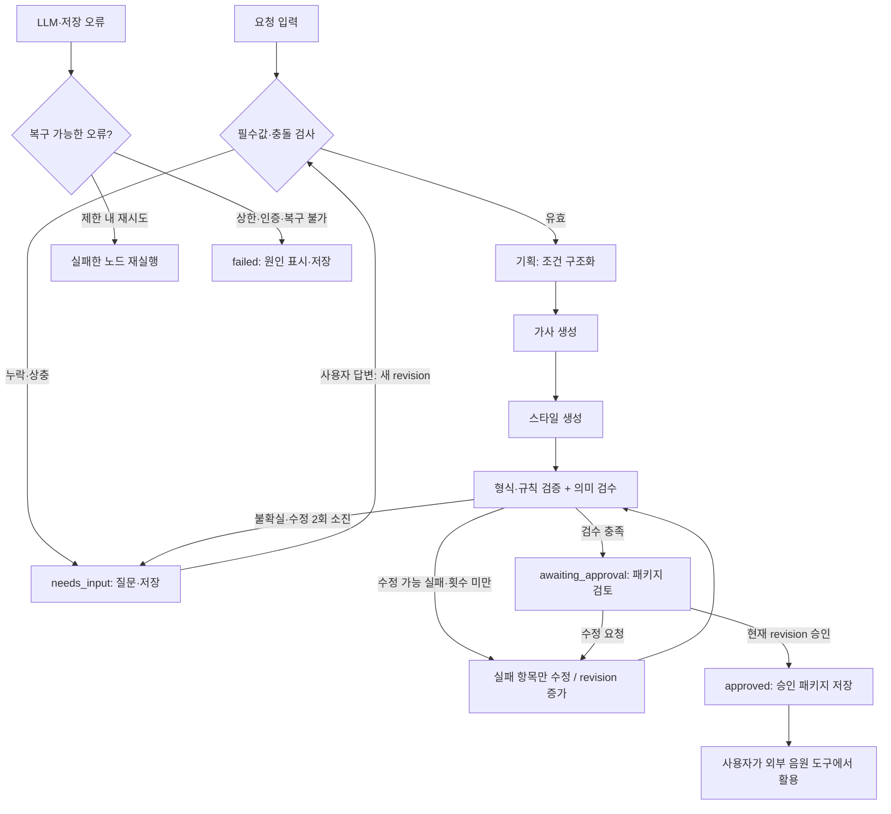

# SongPilot AI MVP 설계서

작성 기준: 2026-10-26 / 단계: 설계 / 실제 서비스·LLM 연동·음원 생성 미구현

## 1. 기획 검토와 결정

‘단일 캠페인의 승인 가능한 음악 제작 패키지를 만드는 과정’으로 범위를 한정하면 학습 프로젝트로 현실적이다. 생성물의 음악적 품질을 보장하기보다, 어떤 요구사항으로 만들었고 무엇을 확인했으며 왜 수정했는지를 설명하는 것이 핵심이다. 요구사항 누락·수정 횟수 감소는 검증할 가설이며 이미 입증된 효과가 아니다.

대표 사용자는 지자체 홍보팀 담당자다. 기업 브랜드·사내문화팀과 교육기관도 같은 구조를 재사용할 수 있다. 첫 시연은 폭염 예방 캠페인 한 건으로 제한한다. 실제 도입 기관, 협업 실적, 성과 수치는 가정하지 않는다.

| 설계 쟁점 | MVP 결정 | 한계와 확인 방법 |
|---|---|---|
| 30초 음악 | 목표 길이를 입력하고 가사 분량·구성만 추정 | 실제 음원 길이는 미검증. 외부 생성 후 별도 확인 |
| 필수 문구 | 사용자가 지정한 문자열의 정확 포함 검사 | 띄어쓰기·문장부호 변경 허용은 사용자가 정한 정책에 따름 |
| 필수 메시지 | 메시지별 가사 근거 구절과 pass/fail/uncertain 기록 | 단어 출현만으로 통과 금지. 불확실하면 사람에게 확인 |
| 표현 적절성 | 규칙 검사 + 독립 검수 역할 + 담당자 승인 | LLM 판정은 사실성·안전성의 보증이 아님 |
| 기관 가이드 | 입력 폼에 짧은 가이드·문구·금지어를 직접 등록 | 문서 검색이 실제로 필요해진 뒤 RAG 검토 |
| 에이전트 협업 | 역할과 입출력 계약을 분리하고 순차 호출 | 에이전트별 별도 서버·모델·자율 도구는 필요 없음 |
| 승인 | 현재 revision의 제작 패키지에 승인 기록 연결 | 실제 음원 및 게시·방송 승인과 별도 |

건강·안전 관련 새 수치나 지침을 모델이 임의로 보완하지 않는다. 제공된 지침이 부족하거나 상충하면 질문을 만들고 중단한다. 이 문서의 폭염 메시지는 사용자가 제공한 가상 업무 요구사항이며, 별도의 공공안전 지침 검증을 수행했다는 뜻이 아니다.

## 2. 최소 아키텍처

Python, LangGraph, Pydantic, Streamlit, 한 공급자의 LLM SDK를 실행 구성으로 사용한다. pytest는 개발 검증에만 사용한다. LangGraph와 MiniFlow를 동시에 도입하지 않는다. 단순 Python 상태머신으로 작은 개념 검증을 할 수 있지만, 본 MVP는 학습 목표인 상태·조건 분기·승인 대기를 드러내기 위해 LangGraph를 권장한다.

LLM 호출부는 `generate(role, input, output_schema)`와 같은 공통 어댑터로 모은다. 공통 JSON 파싱·스키마 오류 처리·시간 제한·호출 기록을 재사용하고, 역할별 프롬프트와 출력 모델만 분리한다. 첫 개발 단계에서는 고정 응답을 반환하는 mock 어댑터를 사용해 API 비용 없이 실패 경로를 만든다.

저장은 단일 사용자 로컬 시연을 전제로 한다. JSON은 제작 패키지의 정본이고 Markdown은 검토용 표현이다. 실행 복원을 위해서는 별도의 영속 체크포인터가 필요하다. 최초 구현은 메모리 체크포인터로 한 세션의 분기·승인만 확인하고, 앱 재시작 복구를 완료 기준으로 삼는 단계에서 SQLite 기반 체크포인터 하나를 추가한다. JSON 파일만 저장하고 LangGraph 실행 위치까지 자동 복구된다고 설명하지 않는다. DB 서버·작업 큐·벡터 DB·여러 LLM 공급자는 도입하지 않는다.

로그인·권한 관리가 없는 로컬 데모의 담당자 이름 입력은 실제 조직의 인증·전자결재를 대체하지 않는다. 기관 배포와 내부 연동은 이번 구현 범위 밖이다.

## 3. 에이전트와 프로그램의 책임

| 역할 / 구성 | 입력 | 출력 | 책임의 경계 |
|---|---|---|---|
| 입력 검증기 | 원문·폼 필드 | 유효 요청 또는 확인 질문 | 필수값·충돌 검사. 누락값을 임의로 채우지 않음 |
| 기획 에이전트 | 검증된 요청·가이드 | 목적·대상·채널·톤·조건의 제작 계획 | 요청 조건을 삭제·완화하지 않음. 추정은 따로 표시 |
| 가사 에이전트 | 계획·필수 문구·메시지·실패 항목 | 가사 문자열 | 쉬운 한국어, 후렴·반복구, 해당 실패 항목 수정 |
| 스타일 에이전트 | 계획·목표 길이·분위기 | Style Prompt·BPM·길이 목표 | 장르·보컬·악기·구조를 기술. 가사를 대신 출력하지 않음 |
| 규칙 검증기 | 요청·현재 가사·스타일 | 항목별 pass/fail 및 근거 | 스키마, 정확 문구, 금지어, 필드·분량 정책 검사 |
| 의미 검수 에이전트 | 원래 요청·현재 결과·가이드 | 메시지별 근거·명확성·불확실성 | 가사 안의 부정·반대 의미도 검토. 생성자의 자기판정만 사용하지 않음 |
| 오케스트레이터 | 현재 상태·오류·검수 | 다음 노드·재시도·질문·상태 기록 | 생성·검수 역할과 별도로 종료 조건을 강제 |
| 담당자 | 결과·근거·차이·경고 | 승인 / 수정 요청 / 조건 변경 | 현재 버전의 최종 의사 결정 |

기획·가사·스타일·검수는 같은 모델을 사용해도 된다. 역할 분리의 근거는 프롬프트 이름이 아니라 각기 다른 입력·출력 계약과 검증 책임이다. 기본 흐름은 순차 실행이며, 성능 측정 전에는 병렬 호출을 추가하지 않는다.

## 4. 워크플로우와 상태

각 LLM·저장 노드에는 X로 가는 오류 경로가 있다. N은 해당 노드로 돌아간다. Mermaid의 간결성을 위해 개별 오류 화살표는 생략했다. 담당자 수정 요청도 같은 수정 횟수 상한을 적용한다. 상한을 넘으면 `needs_input`에서 조건을 확정한 뒤, 사용자가 명시적으로 새로운 실행을 시작한다.

| status | 의미 | 허용되는 다음 행동 |
|---|---|---|
| draft | 입력 또는 수작업 예시, 생성 전 | 수정·입력 검사·실행 |
| running | 생성·검수·제한된 자동 수정 진행 | 상태 확인·실행 종료 |
| needs_input | 누락·상충·의미 불확실·콘텐츠 수정 상한 | 질문에 답변·요청 재정의·새 실행 |
| awaiting_approval | 현재 버전에 필요한 검수 완료 | 승인·수정 요청 |
| approved | 승인된 revision과 현재 revision 일치 | 승인 패키지 출력·새 버전 생성 |
| failed | 인프라·인증·저장 등 실행 실패 | 오류 확인·설정 수정 후 명시적 재실행 |

`status`는 실행 전체 상태이고 `history[].node/status`는 단계별 상태다. 검수 항목의 `not_run`은 통과가 아니다. 가사·스타일·입력 조건을 변경할 때 `revision`을 올리고 이전 검수와 승인을 무효화한다. 이전 revision의 산출물·검수·수정 이유는 이력과 버전별 스냅샷으로 남긴다.

승인 직전에는 `review.content_revision == revision`, 필수 검사 목록의 완전성, 차단 항목 전부 pass, 미해결 질문 없음, 승인할 패키지의 revision 일치를 코드로 다시 확인한다. 승인 이벤트에는 담당자·시각·대상 revision을 기록한다. UI 버튼 활성화 여부만으로 승인 가능성을 판단하지 않는다.

길이 추정 항목은 결과가 ‘분량 적합 추정’이어도 `duration_verified=false`를 유지한다. 실제 음원 길이 검증은 MVP의 필수 검사 집합에 넣지 않고 출력에 미검증으로 명시한다. 명확성·의미 검수의 uncertain은 승인 대기로 넘기지 않고 확인 대기로 보낸다.

## 5. 데이터 계약

`models.py`는 Pydantic v2 데이터 계약 초안이며 `package.schema.json`은 그 구조를 도구에서 사용할 수 있도록 내보낸 JSON Schema다. `example_package.json`은 사람이 작성한 가상 캠페인 데이터로, 실제 에이전트 실행 결과가 아니다. `execution_mode=design_example`, `status=draft`, 검수 미실행, `approval.status=pending`(미승인)으로 표현한다. 세부 필드와 구조 검증 범위는 `data_contract.md`를 참고한다.

| 영역 | 핵심 필드 | 설계 원칙 |
|---|---|---|
| 식별·상태 | schema_version, run_id, revision, status, execution_mode | 스키마 버전과 콘텐츠 버전 분리 |
| 요청 | purpose, audience, channel, target_duration_seconds, language, tone | 사용자가 확정한 값 보존 |
| 필수 조건 | required_messages, required_phrases, forbidden_terms, expression_guidelines | 의미 요구와 정확 문구를 분리 |
| 결과 | plan, lyrics, style | 가사와 Style Prompt 별도 필드 |
| 검수 | review.checks, evidence, content_revision, duration_verified | 검사 근거·종류·실행 여부 기록 |
| 승인 | approval.status, reviewer, decided_at, approved_revision | 현재 콘텐츠 버전에만 유효 |
| 실행 이력 | history, errors, revision_attempts, max_revision_attempts | 노드·상태·원인과 시도 횟수 추적 |

JSON Schema는 형식·범위·열거값을 정의한다. 의미 포함, 금지어 문맥, 검수 항목의 완전성, 승인 권한과 데이터 변조 탐지는 별도 프로그램 로직의 책임이다. Pydantic 사용자 정의 검증 일부가 JSON Schema에 자동 표현되지 않을 수 있으므로 가져온 데이터는 JSON Schema 검사만으로 끝내지 않고 Pydantic·업무 규칙을 다시 적용한다.

LLM 출력의 알 수 없는 필드는 거부하고, 필수 필드 누락·잘못된 타입을 기록한다. 모델이 요청에 없는 필수 조건을 새로 만들거나 기존 조건을 바꾸면 계획 확정을 중단한다. 사용자 텍스트와 기관 가이드는 데이터로 전달하고 시스템 지침을 덮어쓰는 명령으로 취급하지 않는다.

## 6. 검수·실패·재시도 정책

1. 입력 검사: 목적·대상·채널·길이와 최소 메시지 확인. 필수 문구와 금지어 충돌은 생성 전 `needs_input`.
2. 구조 검사: 가사 문자열, 스타일 구조, 빈 필드, 잘못된 JSON 등을 검사. 스키마 실패한 LLM 응답은 제한된 콘텐츠 수정 정책으로 처리.
3. 규칙 검사: 필수 문구 정확 포함, 금지어·출력 형식·설정된 분량 한도. 모든 결과에는 해당 필드와 근거 위치를 기록.
4. 의미 검사: 각 메시지의 가사 근거를 연결하고 부정·반대 의미·모호함을 판정. 근거를 찾지 못하면 pass 금지.
5. 수정: 가사 실패는 가사, 스타일 실패는 스타일에 전달. 실패 항목과 보존할 조건을 함께 제공하고, 수정 후 전체 검수를 다시 수행.
6. 종료: 최초 생성 + 최대 2회 콘텐츠 수정. 해결되지 않으면 확인 질문·실패 원인·마지막 결과를 남기고 대기.

필수 문구는 원문 정확 일치를 기본으로 한다. 의미 검사와 분리된 정책으로, ‘물’이라는 단어가 들어 있어도 ‘물 마시지 마세요’는 메시지 충족이 아니다. 금지어 단순 검사는 정해진 목록에 대한 점검이며 모든 부적절한 표현의 탐지를 보장하지 않는다.

통신 재시도는 콘텐츠 수정과 별도로 집계한다. 예시 정책은 요청당 LLM 호출 최대 12회, 노드별 통신 재시도 최대 2회, 호출당 타임아웃 30초, 전체 실행 시간 상한 180초다. 숫자는 초기 구성값이며 측정 후 조정한다. rate limit은 응답 헤더·공급자 정책을 따르되 전체 시간 상한 안에서만 대기한다. 모든 재시도는 전체 호출 예산을 먼저 검사한다. 인증 오류·유효하지 않은 모델 설정은 즉시 실패하고 API를 반복 호출하지 않는다.

저장 실패는 성공으로 표시하지 않는다. 동일 디렉터리 임시 파일에 쓰고 원자적으로 교체한 후 다시 열어 구조를 검사한다. 중복 클릭은 run_id·실행 잠금으로 중복 생성하지 않으며, 이미 성공한 노드를 재개하면서 불필요하게 반복 호출하지 않는다. 승인 노드 앞에는 외부 부작용을 두지 않는다.

## 7. JSON·Markdown 저장·불러오기

JSON을 정본으로 보관하고 Markdown은 사람이 읽는 보고서와 기계가 읽는 데이터를 함께 담는다. Markdown 생성 시 목적·가사·스타일·검수·상태·승인을 표시하고 끝에 구분된 JSON 코드 블록을 넣는다. 불러오기는 이 블록 1개를 읽어 구조를 검증한 후 화면을 다시 구성한다. 보고서 문장만 임의로 편집한 내용을 자동으로 JSON에 반영하지 않는다.

가져오기 화면은 JSON 데이터가 기준임을 표시하고 미리보기를 제공한다. 손상 JSON, 지원하지 않는 schema_version, 여러 데이터 블록, 누락 블록은 오류로 표시한다. 원문과 JSON이 어긋나면 정본 기준으로 보고서를 다시 만든다. 파일 크기 상한(초기 1MB)·확장자·스키마를 검사하고 임의 경로 쓰기나 파일의 코드를 실행하지 않는다.

초안도 저장할 수 있으나 ‘미승인 / 외부 제작용 확정본 아님’을 표시한다. 승인된 최종 패키지는 승인 revision과 일치할 때만 표시한다. 사용자가 가져온 파일의 승인 기록은 로컬 데모에서 신뢰할 수 있는 전자서명이 아니므로, 가져온 결과는 내용 보존 후 현재 실행의 승인을 pending으로 돌리고 다시 검수한다. 장기 이력은 별도 원본 스냅샷으로 보존한다.

## 8. 화면 구성

입력 화면에는 목적·대상·채널·목표 길이·톤·필수 메시지·정확 문구·금지어·표현 가이드만 둔다. 실행 화면에는 기획 → 가사 → 스타일 → 검수의 현재 상태, 시도 횟수, 실패 이유를 표시한다. 결과 화면에는 ‘가사’, ‘Style Prompt’, ‘검수·수정 이력’을 구분하고 목표 길이와 실제 길이 미검증 상태를 함께 보여준다.

검수 실패 시 실패 항목과 근거를 먼저 보여주고, 수정 중·확인 필요 상태를 명시한다. 통과 시 현재 revision에 대한 승인·수정 요청을 제공한다. 기술적 스택과 내부 프롬프트는 일반 사용 화면의 필수 정보로 넣지 않는다.

## 9. 단계별 구현 순서

| 순서 | 구현할 내용 | 다음 단계로 넘어갈 근거 |
|---|---|---|
| 1 | 데이터 모델·규칙 함수·mock 응답·JSON/Markdown 왕복 | 입력·문구 누락·손상 파일을 코드로 구별 |
| 2 | LangGraph 생성·검수·수정·질문 분기 | 2회 수정 상한과 무한 루프 방지 테스트 통과 |
| 3 | LLM 어댑터 하나 연결, 역할별 프롬프트 | 가상 사례 결과에 메시지 근거와 분리 출력 확인 |
| 4 | Streamlit 상태·이력·승인, 영속 체크포인트 | 동일 revision 승인·수정 무효화·재시작 복구 확인 |
| 5 | 실패 경로 통합 테스트와 시연 패키지 | 아래 MVP 완료 기준 충족 |
| 이후 | 필요 시 Docker → 기관 문서 RAG → 여러 트랙 | 핵심 기능의 효과와 실제 요구를 먼저 확인 |

현재 제공물은 문서·데이터 계약 초안이다. LangGraph 그래프, Streamlit 앱, LLM 연동, 저장·가져오기 서비스, pytest 통합 테스트, Docker·RAG를 구현한 상태로 설명하지 않는다.

## 10. 테스트 시나리오와 완료 기준

아래는 구현할 테스트 계획이며 서비스 테스트의 실행 결과가 아니다. 비용·변동성을 줄이기 위해 분기 테스트는 고정 mock 응답으로 작성하고 실제 LLM은 대표 시나리오의 제한된 수동 확인에 사용한다.

| ID | 상황 | 기대 결과 |
|---|---|---|
| T01 | 정상 폭염 캠페인 | 가사·스타일 분리, 검수 근거, 승인 대기 |
| T02 | 목적·대상·채널 누락 | 생성 호출 없이 needs_input과 질문 |
| T03 | 필수 문구와 금지어 충돌 | 조건 임의 삭제 없이 확인 대기 |
| T04 | LLM JSON 누락 필드·문자열 대신 숫자 | 구조 오류 기록, 제한 내 수정 |
| T05 | 정확 문구 하나 누락 | 해당 항목 fail, 가사 수정 뒤 전체 재검수 |
| T06 | ‘물’은 있으나 ‘물 마시지 마세요’ | 의미 실패·확인, 키워드만으로 통과 금지 |
| T07 | 금지 표현 포함 | 원문 근거·필드 표시와 수정 분기 |
| T08 | 의미가 모호하거나 근거 구절 없음 | uncertain, 자동 승인 대기 진입 금지 |
| T09 | 목표 30초에 비해 긴 가사 | 분량 경고·수정, 실제 길이 미검증 유지 |
| T10 | 2회 수정해도 메시지 누락 | 자동 호출 종료, needs_input |
| T11 | 타임아웃·일시적 오류·rate limit | 제한 내 통신 재시도, 횟수·시간 상한 준수 |
| T12 | 인증 오류 또는 전체 호출 예산 소진 | 무한 반복 없이 failed와 원인 표시 |
| T13 | 검수 실패·이전 revision 승인 시도 | 서버 로직에서 승인 차단 |
| T14 | 승인 후 가사·요구사항 수정 | revision 증가, 이전 검수·승인 무효화 |
| T15 | JSON 및 Markdown 왕복 | 요청·결과·검수·이력 보존, 새 승인은 pending |
| T16 | 손상·지원하지 않는 버전·JSON 블록 없음 | 안전한 가져오기 오류, 기존 작업 보존 |
| T17 | 승인 대기에서 앱 재시작 | 동일 실행 복구, 중복 LLM 생성 없이 재개 |
| T18 | 저장 권한 오류·디스크 쓰기 실패 | 저장 성공 오표시 금지, 복구 가능한 오류 표시 |
| T19 | 중복 실행 클릭·재개 중복 | run_id 단위 중복 방지, 시도·버전 이력 일관 |
| T20 | 미승인·design_example 데이터 출력 | 초안 표시, 승인된 실사용 패키지로 오인 방지 |

MVP 완료는 T01~T20 기대 결과를 재현하고, 가상 요청에서 JSON·Markdown 제작 패키지와 단계별 상태·검수·수정 이력을 확인할 수 있을 때 선언한다. 자동 검수 통과만으로 실제 음원 품질·길이·권리·방송 적합성의 검증 완료를 선언하지 않는다. 외부 음원 생성 이후의 최종 확인·게시 승인은 별도 절차다.

## 참고 자료와 적용 범위

- [Wavenox Suno Command Maker](https://free.wavenox.com/tools/suno-command-maker/): 사용자 제공 레퍼런스. 2026-10-26 접근 오류로 세부 기능은 확인하지 못했으며, 비교 우위나 동일 기능을 검증한 것으로 기술하지 않았다.
- [LangGraph overview](https://docs.langchain.com/oss/python/langgraph/overview): 상태 기반 오케스트레이션 도구 선택의 참고 자료.
- [LangGraph interrupts](https://docs.langchain.com/oss/python/langgraph/interrupts): 승인 중단·재개에는 체크포인터와 같은 thread_id가 필요하고, 재개 시 노드 시작 부분이 다시 실행될 수 있으므로 그 앞의 부작용을 피한다.
- [Pydantic models](https://docs.pydantic.dev/latest/concepts/models/): 구조 검증·직렬화·JSON Schema 생성의 참고 자료. 모델이 보장하는 타입·제약과 내용의 사실성을 구분했다.

공식 문서를 참고한 설계이며, 특정 라이브러리 버전에서 본 애플리케이션이 동작한다고 검증한 것은 아니다. 실제 구현 시작 시 호환 버전을 확인하고 고정한다.
