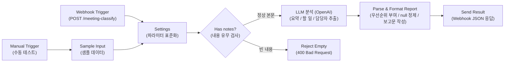

# 66-agy: 회의록 분석 및 할 일/참석자 분류 n8n 워크플로우

회의록 텍스트를 웹훅으로 수신하여 OpenAI LLM으로 **2문장 요약**, **할 일 목록(Action Items: 우선순위 및 null 처리)**, **공유용 정리문(report_text)**을 생성하여 구조화된 JSON으로 반환하는 n8n 시나리오입니다.

---

## 1. 워크플로우 흐름도 (가로 레이아웃)



---

## 2. 한눈에 보는 파이프라인 명세

| 단계 | 노드명 | 노드 유형 | 입력 (Input) | 출력 (Output) / 핵심 로직 |
| :---: | :--- | :---: | :--- | :--- |
| **1** | **Meeting webhook** | `webhook` | HTTP POST Body | `body.title`, `body.notes` 수신 |
| **1-ALT** | **Manual & Sample** | `manual` + `set` | 수동 실행 버튼 | 기본 회의록 샘플 텍스트 자동 주입 |
| **2** | **Settings** | `set` | 웹훅/수동 입력 데이터 | `llm_url`, `model`(`gpt-4.1-mini`), `notes`, `title` 통합 |
| **3** | **Has notes?** | `if` | `notes` 문자열 | 빈 문자열 체크 (False 분기 시 400 에러 즉시 반환) |
| **4** | **LLM extract** | `httpRequest` | `notes` 프롬프트 | OpenAI Chat API (`response_format: json_schema`) 요약 및 할 일 추출 |
| **5** | **Parse & Format** | `code` | LLM JSON 결과 | 오늘 마감 $\to$ `높음`, 기타 $\to$ `보통`, 미정 $\to$ `null`, `report_text` 조립 |
| **6** | **Send result** | `respondToWebhook` | 최종 JSON 데이터 | 호출자에게 HTTP 200 상태코드 및 요구 규격 JSON 반환 |

---

## 3. LLM 시스템 프롬프트 (System Prompt)

### 3.1. 프롬프트 설계 규칙 요약 (가로 표)

| 항목 | 구분 | 적용 규칙 및 지침 |
| :--- | :---: | :--- |
| **역할 (Role)** | 분석관 | 회의록에서 요약, 참석자, 업무 실행 항목(Action Items)을 추출하는 전문 어시스턴트 |
| **요약 (summary)** | 2문장 요약 | 회의 핵심 내용을 한국어 최대 2문장으로 간결하게 작성 |
| **할 일 (task)** | 업무 요약 | 무엇을 해야 하는지 명확한 한국어 개조식 문장으로 작성 |
| **담당자 (owner)** | 인물 지정 | 명시된 담당자 기입. 미지정이거나 "다음 회의에서 결정"인 경우 반드시 **`null`** 처리 |
| **기한 (due)** | 일정 지정 | 마감 시점(예: "금요일", "오늘 중") 기입. 미언급 시 반드시 **`null`** 처리 |
| **우선순위 (priority)** | 자동 판별 | `due`에 "오늘", "금일", "긴급" 포함 시 $\to$ **`"높음"`**, 그 외/이번 주 $\to$ **`"보통"`** |
| **보고문 (report_text)** | 공유용 문구 | 메신저/이메일 공유에 적합한 개조식 정리문 자동 생성 |

### 3.2. 실제 적용 시스템 프롬프트

```text
You analyze meeting notes. Extract structured data in strict JSON conforming to the schema:
1. summary: A concise summary of the meeting in Korean (at most 2 sentences).
2. attendees: Array of attendee names in Korean.
3. actions: Array of actionable tasks:
   - task: Description of the task in Korean.
   - owner: Name of the assigned person. If not assigned or to be decided later, set to null.
   - due: Deadline or due date in Korean (e.g. "금요일", "오늘 중"). If not specified, set to null.
4. next_meeting: Next meeting schedule or null if not stated.

Rules:
- Never use placeholder strings like "미정" or "없음" for owner/due; use literal null.
- Return pure JSON only.
```

---

## 4. 입출력 데이터 명세 및 결과

### 4.1. 샘플 입력 (Input)

```json
{
  "title": "10월 16일 주간 회의",
  "notes": "참석: 김민지, 이준호, 박서연. 1) 신규 고객 문의 응답 템플릿을 이준호가 금요일까지 정리한다. 2) 박서연은 다음 주 월요일까지 VPN 장애 보고서를 작성한다. 3) 서버 점검 일정은 김민지가 오늘 중 공지한다. 4) 회의실 예약 규칙 개선은 담당자를 다음 회의에서 정한다. 다음 회의는 10월 23일."
}
```

### 4.2. 최종 반환 JSON 응답 (Output)

```json
{
  "title": "10월 16일 주간 회의",
  "route": "할 일 정리",
  "count": 4,
  "summary": "신규 고객 문의 템플릿 정리, VPN 장애 보고서 작성, 서버 점검 공지 등 주요 업무 일정을 확인했습니다. 회의실 예약 규칙 개선 담당자는 차기 회의에서 지정하기로 했습니다.",
  "actions": [
    {
      "task": "신규 고객 문의 응답 템플릿 정리",
      "owner": "이준호",
      "due": "금요일",
      "priority": "보통"
    },
    {
      "task": "VPN 장애 보고서 작성",
      "owner": "박서연",
      "due": "다음 주 월요일",
      "priority": "보통"
    },
    {
      "task": "서버 점검 일정 공지",
      "owner": "김민지",
      "due": "오늘 중",
      "priority": "높음"
    },
    {
      "task": "회의실 예약 규칙 개선",
      "owner": null,
      "due": null,
      "priority": "보통"
    }
  ],
  "report_text": "10월 16일 주간 회의\n신규 고객 문의 템플릿 정리, VPN 장애 보고서 작성, 서버 점검 공지 등 주요 업무 일정을 확인했습니다.\n\n[할 일 목록]\n1. [보통] 신규 고객 문의 응답 템플릿 정리 - 이준호 (금요일)\n2. [보통] VPN 장애 보고서 작성 - 박서연 (다음 주 월요일)\n3. [높음] 서버 점검 일정 공지 - 김민지 (오늘 중)\n4. [보통] 회의실 예약 규칙 개선 - 담당자 미정 (기한 미정)"
}
```

<details>
<summary><b>▶ [펼치기] cURL 테스트 명령어</b></summary>

```bash
curl -X POST http://localhost:5678/webhook/meeting-classify \
  -H "Content-Type: application/json" \
  -d '{
    "title": "10월 16일 주간 회의",
    "notes": "참석: 김민지, 이준호, 박서연. 1) 신규 고객 문의 응답 템플릿을 이준호가 금요일까지 정리한다. 2) 박서연은 다음 주 월요일까지 VPN 장애 보고서를 작성한다. 3) 서버 점검 일정은 김민지가 오늘 중 공지한다. 4) 회의실 예약 규칙 개선은 담당자를 다음 회의에서 정한다. 다음 회의는 10월 23일."
  }'
```
</details>

---

## 5. 빠른 가이드

| 번호 | 단계 | 설명 |
| :---: | :--- | :--- |
| **1** | **Import** | n8n 대시보드 우측 상단 `Import from File` 클릭 후 [`66-agy.json`](file:///mnt/c/aio-01d4-stu/tmp/66-agy.json) 파일 불러오기 |
| **2** | **Credential** | `LLM extract` 노드의 OpenAI 인증 정보(`openAiCourse0001` 또는 개인 API 키) 확인 |
| **3** | **수동 테스트** | `Manual Trigger` 노드 실행 시 내장된 샘플 데이터로 즉시 노드별 결과 확인 가능 |
| **4** | **웹훅 실행** | 워크플로우 활성화(`Active: On`) 후 `http://<host>:5678/webhook/meeting-classify`로 POST 요청 전송 |
