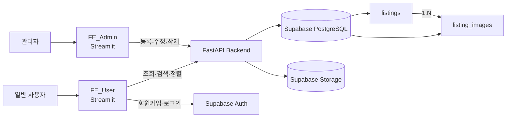
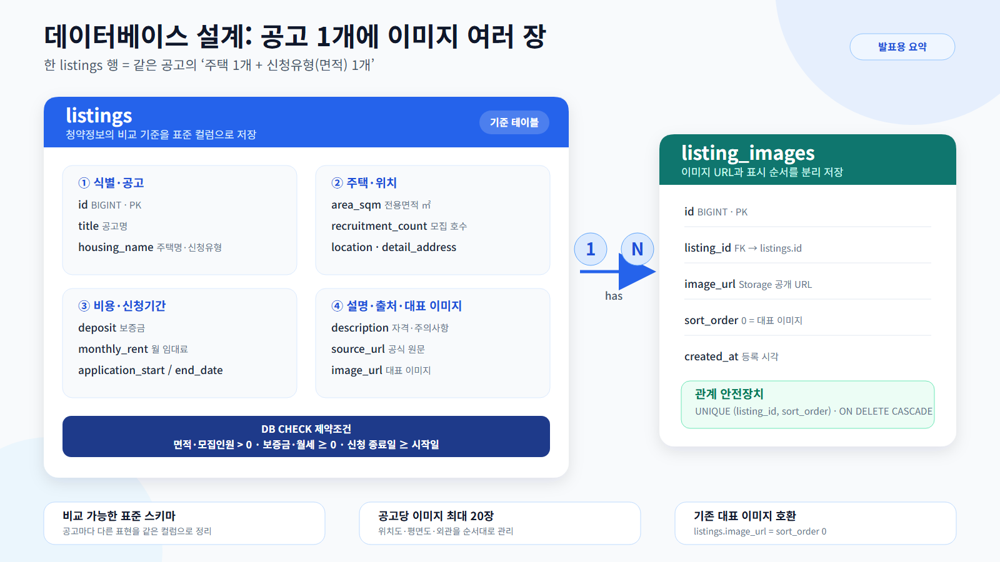
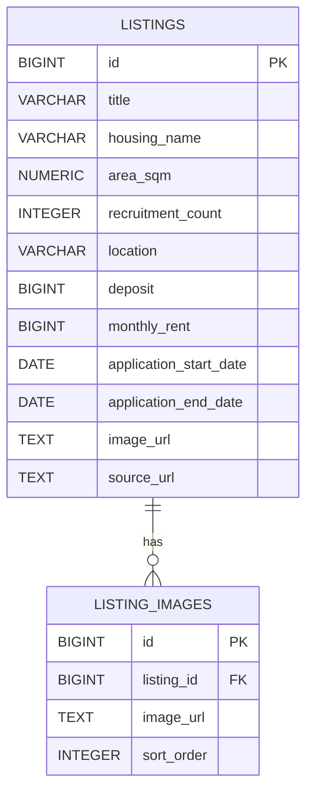
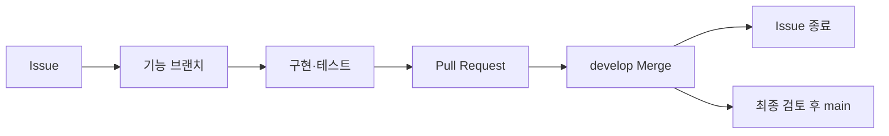
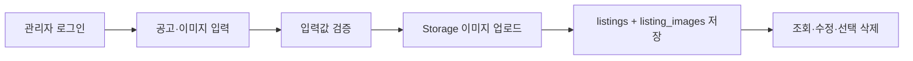

# 공공임대 및 분양 청약 통합 안내 서비스

> 웹 서비스 기초 및 AI 백엔드 개발 단위 프로젝트 · **1팀**<br>
> 여러 기관의 청약 공고를 비교하기 쉬운 형식으로 정리하고, 관리자 등록부터 사용자 조회까지 연결한 웹 서비스 MVP

현재 발표 범위는 **관리자가 공식 공고를 확인해 수동 등록하는 버전**입니다. 청약 신청을 대행하지 않으며, 사용자가 최종 판단 전에 공식 원문을 확인할 수 있도록 출처 링크를 제공합니다.

## 발표·배포 링크

| 구분 | 링크 |
| --- | --- |
| 사용자 서비스 | 배포 후 입력 |
| 관리자 서비스 | 배포 후 입력 |
| FastAPI Swagger | 배포 후 입력 |
| 전체 시연 영상 | 녹화 후 입력 |
| GitHub Repository | [kiwi248/aio-01-p1-team1](https://github.com/kiwi248/aio-01-p1-team1) |

---

## 1. 문제 정의

공공임대·분양 정보는 한 기관에서만 제공되지 않습니다.

- [LH청약플러스](https://apply.lh.or.kr/)는 LH가 공급하는 임대·분양 공고와 첨부 문서를 제공합니다.
- [SH인터넷청약시스템](https://www.i-sh.co.kr/)은 서울주택도시개발공사의 공고와 청약 절차를 제공합니다.
- [청약Home](https://www.applyhome.co.kr/ai/aia/selectAPTLttotPblancListView.do)는 아파트 분양정보·청약일정·경쟁률 중심입니다.
- [마이홈포털](https://www.myhome.go.kr/)은 다양한 공공임대 유형과 자격 정보를 안내합니다.

공식 사이트들은 각 기관의 업무에는 적합하지만, 서로 다른 기관의 공고를 같은 기준으로 비교하려는 사용자에게는 다음 탐색 비용이 생깁니다. 이는 공식 사이트의 제공 범위와 공고 표현 방식을 비교해 도출한 프로젝트 관점의 분석입니다.

| 기존 탐색 과정의 어려움 | 프로젝트 해결 전략 |
| --- | --- |
| 공급기관·주택유형에 따라 사이트를 옮겨 다녀야 함 | 관리자가 공식 원문을 검증해 하나의 서비스에 통합 등록 |
| 핵심 조건이 PDF·HWP·별도 표에 나뉘어 있음 | 면적·모집인원·보증금·월세·신청기간을 표준 컬럼으로 정리 |
| 공고별 표현 방식이 달라 빠른 비교가 어려움 | 동일한 카드와 상세 정보 구조로 표시 |
| 신청 종료일까지 남은 시간을 직접 계산해야 함 | D-day와 마감 임박순 제공 |
| 제곱미터와 긴 원 단위 금액이 직관적이지 않음 | 약식 평수와 억·만 단위 금액 병기 |
| 위치도·평면도·외관 이미지가 문서에 흩어짐 | 공고당 최대 20장 이미지 갤러리 제공 |
| 마감 공고가 현재 공고와 섞여 탐색을 방해함 | 마감 공고를 흐리게 표시하고 목록 뒤로 이동 |

### 핵심 가치

> **공식 원문은 신뢰의 기준으로 남기고, 비교와 탐색 과정은 더 짧고 읽기 쉽게 만든다.**

---

## 2. 주요 기능

### 사용자 청약정보 조회

- 지역·최대 보증금·최대 월세 조건 검색
- `D-3`, `D-DAY`, `마감` 표시
- 마감된 공고를 흐리게 표시하고 목록 뒤로 이동
- 한 페이지에 10건씩 조회, 새로고침 후에도 페이지 유지
- 전용면적을 `19.08㎡ (약 5.8평)`처럼 병기
- 금액을 쉼표와 억·만 단위로 표시
- 여러 이미지를 갤러리로 조회
- 공식 공고 원문 링크 제공

### 10가지 정렬

- 등록 최신순
- 신청 종료일 빠른순
- 면적 넓은 순 / 좁은 순
- 모집인원 많은 순 / 적은 순
- 보증금 높은 순 / 낮은 순
- 월세 높은 순 / 낮은 순

정렬은 현재 화면에 보이는 10건만 바꾸는 것이 아니라, 백엔드와 DB에서 전체 데이터에 적용한 뒤 페이지를 나눕니다.

### 관리자 청약정보 등록

- 청약 공고 필수 정보와 상세주소 입력
- JPEG·PNG·WebP 이미지 최대 20장 업로드
- 첫 이미지를 대표 이미지로 사용
- 비슷한 주택형 반복 등록을 위해 성공 후 입력값 유지
- 새 공고 입력을 위한 `입력 초기화` 버튼
- 금액 입력 중 쉼표와 억·만 단위 안내

### 관리자 청약정보 조회·삭제

- 검색·정렬·10건 단위 페이지 조회
- 공고 정보 및 이미지 개별 수정·삭제
- 새로고침과 브라우저 뒤로가기 후 작업 위치 복원
- 현재 페이지 전체 선택·선택 해제·선택 삭제
- 삭제 전 대상 목록 확인
- 일부 실패 시 성공·실패 건수 구분 표시

---

## 3. 시스템 아키텍처



- 백엔드 API 하나에 관리자·사용자 Streamlit 앱 두 개가 연결됩니다.
- 사용자 인증은 Supabase Auth가 직접 담당합니다.
- FastAPI가 Pydantic 검증 후 PostgreSQL과 Storage를 처리합니다.
- 이미지 파일은 Storage에, 공고 관계와 순서는 DB에 저장합니다.

자세한 흐름: [시스템 아키텍처 문서](docs/presentation/system_architecture.md)

---

## 4. 시스템 구성

| 구성 | 기술 | 역할 |
| --- | --- | --- |
| FE_User | Streamlit, httpx | 사용자 인증, 공고 검색·정렬·상세 조회 |
| FE_Admin | Streamlit, httpx | 관리자 로그인, 공고 등록·수정·삭제 |
| BE | FastAPI, Pydantic, Uvicorn | API, 입력 검증, 비즈니스 규칙 |
| Database | Supabase PostgreSQL | 공고와 관계 데이터 저장 |
| Auth | Supabase Auth | 사용자 이메일 회원가입·로그인 |
| Storage | Supabase Storage | 공고 이미지 파일 저장 |
| 배포 목표 | Render, Streamlit Community Cloud | 백엔드와 두 프런트엔드 배포 |

세부 구성과 API: [시스템 구성 문서](docs/presentation/system_components.md)

---

## 5. 데이터베이스 설계





### listings

한 행은 같은 공고 안의 **주택 1개 + 신청유형(면적) 1개**입니다.

- 필수 정보: 공고명, 주택명, 면적, 모집인원, 자치구, 보증금, 월세, 신청기간, 설명, 원문 URL
- 선택 정보: 상세주소, 대표 이미지
- 면적·인원은 0보다 커야 함
- 보증금·월세는 0 이상
- 신청 종료일은 시작일보다 빠를 수 없음
- 위치·금액·신청일 인덱스로 검색과 정렬 지원

### listing_images

- `listing_id`로 `listings.id` 참조
- 한 공고에 여러 이미지 연결
- `sort_order = 0`이 대표 이미지
- `(listing_id, sort_order)` 중복 방지
- 공고 삭제 시 `ON DELETE CASCADE`로 연결 행 삭제
- Storage에는 실제 파일, DB에는 URL 저장
- 최대 20장 제한은 관리자 UI와 FastAPI에서 검증

전체 컬럼과 SQL: [데이터베이스 설계 문서](docs/presentation/database.md)

실행 SQL:

- [`BE/sql/schema.sql`](BE/sql/schema.sql)
- [`BE/sql/create_listing_images.sql`](BE/sql/create_listing_images.sql)

---

## 6. 담당 업무 — 청약정보 등록·조회·삭제

### 구현 내용

1. 청약정보 등록 필수 컬럼을 정의하고 `listings` 테이블 구축
2. `listing_images` 1:N 테이블과 Supabase Storage를 연결해 이미지 최대 20장 관리
3. D-day, 마감 임박순, 마감 공고 흐림·후순위 처리
4. 10건 단위 페이지네이션, 평수 병기, 금액·공고 가독성 개선
5. 면적·모집인원·보증금·월세 양방향을 포함한 10개 정렬 기준
6. 관리자 등록 후 값 유지, 입력 초기화, 금액 입력 보조
7. 새로고침 후 로그인 복원과 브라우저 뒤로가기 상태 복원
8. 현재 페이지 전체 선택·선택 해제·선택 삭제

### 개발 프로세스



`main`은 직접 수정하지 않고 기능별 Issue와 PR을 사용했습니다.

세부 문제·해결·대표 PR: [업무 설명 문서](docs/presentation/work_description.md)

---

## 7. 대표 사용자 흐름

### 관리자



### 사용자


---

## 8. 발표 시연 순서

1. 사용자 페이지에서 D-day, 평수, 읽기 쉬운 금액을 보여 줍니다.
2. 보증금 낮은 순과 면적 넓은 순으로 정렬합니다.
3. 마감 공고가 흐려지고 뒤로 이동한 것을 확인합니다.
4. 2페이지로 이동한 뒤 새로고침해 페이지가 유지되는지 보여 줍니다.
5. 여러 이미지가 있는 공고 상세와 원문 링크를 확인합니다.
6. 관리자 화면에서 비슷한 공고를 연속 등록하며 값 유지 기능을 보여 줍니다.
7. `입력 초기화` 버튼으로 새 폼을 만듭니다.
8. 조회/삭제 화면에서 전체 선택, 일부 해제, 선택 삭제 확인창을 보여 줍니다.
9. Swagger에서 조회·등록·이미지 API를 보여 줍니다.

촬영 계획과 파일명: [캡처·GIF·영상 가이드](docs/presentation/capture_recording_guide.md)

---

## 9. 발표 시간 구성 예시

| 시간 | 내용 |
| --- | --- |
| 0~2분 | 문제 정의와 서비스 목표 |
| 2~5분 | 시스템 아키텍처와 역할 분리 |
| 5~8분 | DB 설계와 다중 이미지 구조 |
| 8~15분 | 사용자·관리자 핵심 기능 시연 |
| 15~18분 | 담당 업무와 Issue·PR 개발 과정 |
| 18~20분 | 한계, 개선 방향, 질의응답 연결 |

---

## 10. 실행 방법

### 사전 준비

- Python 3.11 이상
- Supabase 프로젝트
- Supabase SQL Editor에서 다음 파일 실행
  - `BE/sql/schema.sql`
  - `BE/sql/create_listing_images.sql`

### FastAPI

```powershell
cd BE
python -m venv .venv
.venv\Scripts\Activate.ps1
pip install -r requirements.txt
uvicorn app.main:app --reload
```

`BE/.env`:

```env
SUPABASE_URL=https://your-project.supabase.co
SUPABASE_SERVICE_ROLE_KEY=your-service-role-key
```

Swagger: `http://127.0.0.1:8000/docs`

### 관리자 Streamlit

```powershell
cd FE_Admin
python -m venv .venv
.venv\Scripts\Activate.ps1
pip install -r requirements.txt
streamlit run app.py
```

### 사용자 Streamlit

```powershell
cd FE_User
python -m venv .venv
.venv\Scripts\Activate.ps1
pip install -r requirements.txt
streamlit run app.py --server.port 8502
```

`FE_User/.env`:

```env
SUPABASE_URL=https://your-project.supabase.co
SUPABASE_ANON_KEY=your-anon-public-key
```

> 프런트엔드에는 Service Role Key를 넣지 않습니다.

---

## 11. 테스트

각 폴더에서 표준 `unittest`를 실행합니다.

```powershell
cd BE
python -m unittest discover -s tests

cd ..\FE_Admin
python -m unittest discover -s tests

cd ..\FE_User
python -m unittest discover -s tests
```

---

## 12. 현재 한계와 개선 방향

| 현재 한계 | 개선 방향 |
| --- | --- |
| 공고를 관리자가 수동으로 정리 | PDF/HWPX 문서 기반 자동 추출 후 관리자 검수 |
| 관리자 세션이 실제 API 인증을 대신하지 못함 | 만료되는 서명 토큰과 백엔드 권한 검증 |
| 보증금·월세 중심의 임대형 스키마 | 분양가·공급유형·청약자격 구조 추가 |
| 이미지 업로드와 공고 등록이 두 요청으로 분리 | 임시 업로드·등록 확정 또는 보상 삭제 설계 |
| 실제 배포 환경 검증과 촬영 미완료 | 배포 후 핵심 시나리오 회귀 테스트와 영상 기록 |

---

## 13. 문서

- [초기 프로젝트 계획서](docs/plan.md)
- [시스템 아키텍처](docs/presentation/system_architecture.md)
- [시스템 구성 및 기능 흐름](docs/presentation/system_components.md)
- [업무 설명](docs/presentation/work_description.md)
- [담당 기능 4분 발표안](docs/presentation/work-presentation-4min.md)
- [데이터베이스 설계와 SQL](docs/presentation/database.md)
- [캡처·GIF·영상 가이드](docs/presentation/capture_recording_guide.md)
- [20분 발표 대본 초안](docs/presentation/presentation_script.md)
