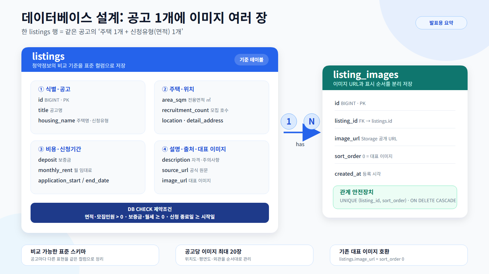
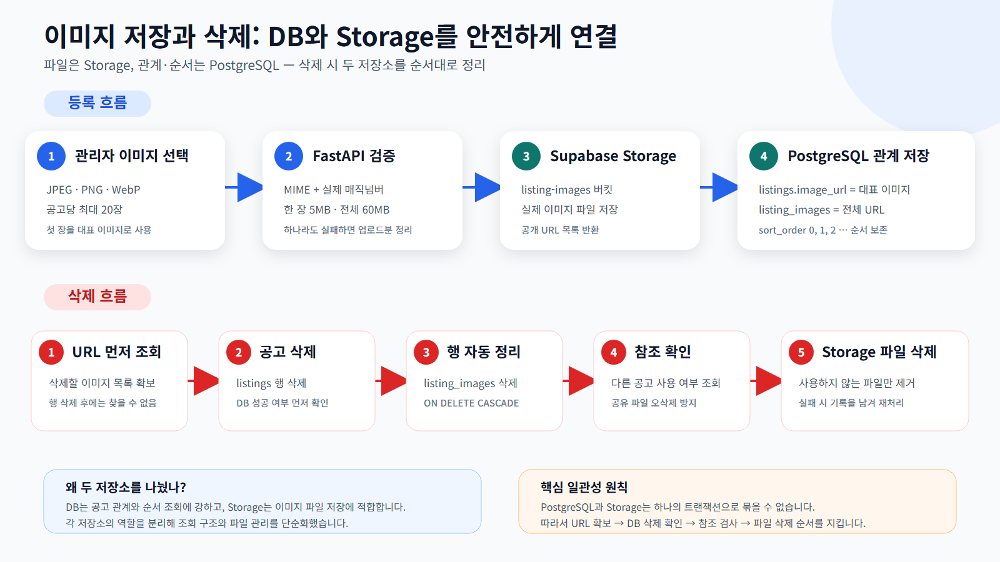
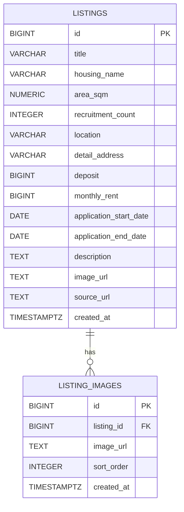

# 데이터베이스 설계 — listings와 listing_images





## 1. 관계



한 `listings` 행은 같은 공고 안의 **주택 1개 + 신청유형(면적) 1개**를 의미합니다. 한 공고에 주택이나 주택형이 여러 개면 비교 가능한 여러 행으로 나눕니다.

## 2. listings 테이블

| 컬럼 | 타입 | 필수 | 설명 |
| --- | --- | --- | --- |
| `id` | BIGINT | O | 자동 증가 PK |
| `title` | VARCHAR(255) | O | 공고명 |
| `housing_name` | VARCHAR(255) | O | 주택명·신청유형 |
| `area_sqm` | NUMERIC(10,2) | O | 전용면적 ㎡ |
| `recruitment_count` | INTEGER | O | 모집 호수 |
| `location` | VARCHAR(50) | O | 서울 자치구 |
| `detail_address` | VARCHAR(255) | 선택 | 도로명 상세주소 |
| `deposit` | BIGINT | O | 보증금, 원 단위 |
| `monthly_rent` | BIGINT | O | 월 임대료, 원 단위 |
| `application_start_date` | DATE | O | 신청 시작일 |
| `application_end_date` | DATE | O | 신청 종료일 |
| `description` | TEXT | O | 자격·주의사항 등 상세 설명 |
| `image_url` | TEXT | 선택 | 대표 이미지 URL |
| `source_url` | TEXT | O | 공식 원문 링크 |
| `created_at` | TIMESTAMPTZ | O | 등록 시각 |

### 제약조건

- `area_sqm > 0`
- `recruitment_count > 0`
- `deposit >= 0`
- `monthly_rent >= 0`
- `application_end_date >= application_start_date`

### 주요 인덱스

- `location`: 자치구 검색
- `deposit`, `monthly_rent`: 최대 금액 검색과 정렬
- `application_start_date DESC`: 신청 시작·등록 관련 정렬
- `application_end_date`: 마감 임박순과 마감 여부 판단

### SQL

```sql
CREATE TABLE IF NOT EXISTS listings (
    id                     BIGINT GENERATED ALWAYS AS IDENTITY PRIMARY KEY,
    title                  VARCHAR(255) NOT NULL,
    housing_name           VARCHAR(255) NOT NULL,
    area_sqm               NUMERIC(10,2) NOT NULL,
    recruitment_count      INTEGER NOT NULL,
    location               VARCHAR(50) NOT NULL,
    detail_address         VARCHAR(255),
    deposit                BIGINT NOT NULL,
    monthly_rent           BIGINT NOT NULL,
    application_start_date DATE NOT NULL,
    application_end_date   DATE NOT NULL,
    description            TEXT NOT NULL,
    image_url              TEXT,
    source_url             TEXT NOT NULL,
    created_at             TIMESTAMPTZ NOT NULL DEFAULT now(),

    CONSTRAINT ck_listings_area_sqm
        CHECK (area_sqm > 0),
    CONSTRAINT ck_listings_recruitment_count
        CHECK (recruitment_count > 0),
    CONSTRAINT ck_listings_deposit
        CHECK (deposit >= 0),
    CONSTRAINT ck_listings_monthly_rent
        CHECK (monthly_rent >= 0),
    CONSTRAINT ck_listings_application_period
        CHECK (application_end_date >= application_start_date)
);
```

전체 실행 파일: [`BE/sql/schema.sql`](../../BE/sql/schema.sql)

## 3. listing_images 테이블

| 컬럼 | 타입 | 필수 | 설명 |
| --- | --- | --- | --- |
| `id` | BIGINT | O | 이미지 행 PK |
| `listing_id` | BIGINT | O | `listings.id` FK |
| `image_url` | TEXT | O | Supabase Storage 공개 URL |
| `sort_order` | INTEGER | O | 표시 순서, 0이 대표 이미지 |
| `created_at` | TIMESTAMPTZ | O | 등록 시각 |

### 설계 이유

- `listings.image_url` 한 칸만으로는 한 공고에 사진 한 장만 저장할 수 있습니다.
- 1:N 테이블로 분리하면 이미지 개별 추가·삭제와 순서 관리가 가능합니다.
- `ON DELETE CASCADE`로 공고를 삭제할 때 연결 행이 남지 않습니다.
- `(listing_id, sort_order)` Unique Constraint로 같은 위치가 중복되지 않습니다.
- 기존 공고와 화면을 깨뜨리지 않기 위해 `listings.image_url`은 대표 이미지 용도로 유지했습니다.
- 실제 파일은 Storage에, 관계와 순서는 DB에 저장해 역할을 분리했습니다.

### SQL

```sql
CREATE TABLE IF NOT EXISTS listing_images (
    id         BIGINT GENERATED ALWAYS AS IDENTITY PRIMARY KEY,
    listing_id BIGINT NOT NULL
        REFERENCES listings(id) ON DELETE CASCADE,
    image_url  TEXT NOT NULL,
    sort_order INTEGER NOT NULL DEFAULT 0,
    created_at TIMESTAMPTZ NOT NULL DEFAULT now(),

    CONSTRAINT uq_listing_images_order
        UNIQUE (listing_id, sort_order),
    CONSTRAINT ck_listing_images_sort_order
        CHECK (sort_order >= 0)
);

CREATE INDEX IF NOT EXISTS idx_listing_images_listing_id
    ON listing_images(listing_id, sort_order);

CREATE INDEX IF NOT EXISTS idx_listing_images_image_url
    ON listing_images(image_url);
```

전체 실행 파일: [`BE/sql/create_listing_images.sql`](../../BE/sql/create_listing_images.sql)

## 4. 이미지 저장 규칙

- Storage bucket: `listing-images`
- 허용 형식: JPEG, PNG, WebP
- 한 장 최대 크기: 5MB
- 한 공고 최대 장수: 20장
- 한 번에 업로드 가능한 전체 크기: 60MB
- `sort_order = 0`: 대표 이미지
- 대표 이미지는 `listings.image_url`과 같은 URL 유지

사진 20장 제한은 DB Constraint가 아니라 관리자 UI와 FastAPI에서 검증합니다.

## 5. 삭제 일관성

1. 공고 삭제 전에 연결된 이미지 URL을 읽습니다.
2. `listings` 행을 삭제합니다.
3. FK Cascade로 `listing_images` 행이 함께 삭제됩니다.
4. 다른 공고가 사용하지 않는 이미지인지 확인합니다.
5. Supabase Storage의 실제 파일을 삭제합니다.

PostgreSQL과 Storage는 하나의 DB 트랜잭션으로 묶을 수 없으므로 이 순서와 실패 기록이 중요합니다.

## 6. 현재 제한과 확장 방향

- 현재 필드는 보증금·월세 중심이라 공공임대 공고 표현에 더 적합합니다.
- 분양 공고까지 완전하게 정규화하려면 `listing_type`, `sale_price`, `supply_type` 등의 확장이 필요합니다.
- 공고와 주택형이 반복되는 구조가 커지면 `notices`와 `housing_units`로 한 번 더 분리할 수 있습니다.
- 이미지 최대 장수는 필요하면 DB Trigger나 별도 정책으로도 강제할 수 있습니다.
