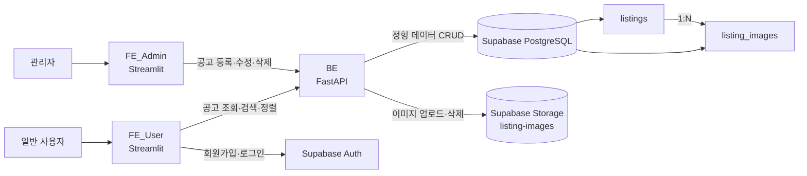
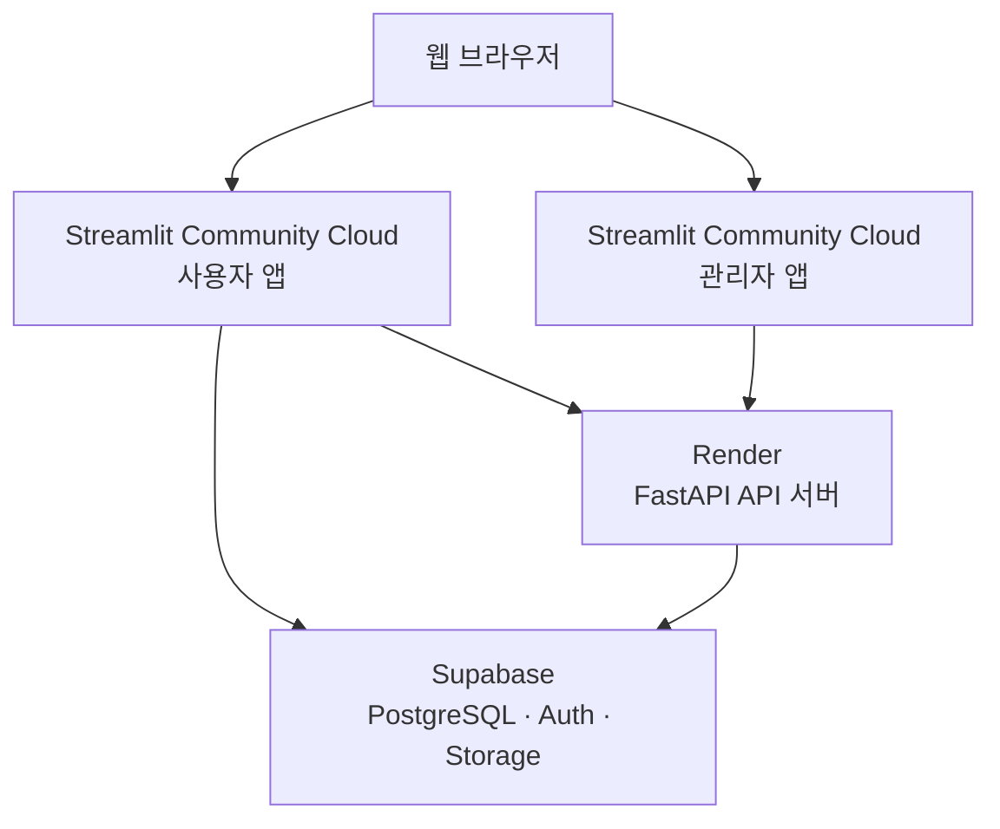
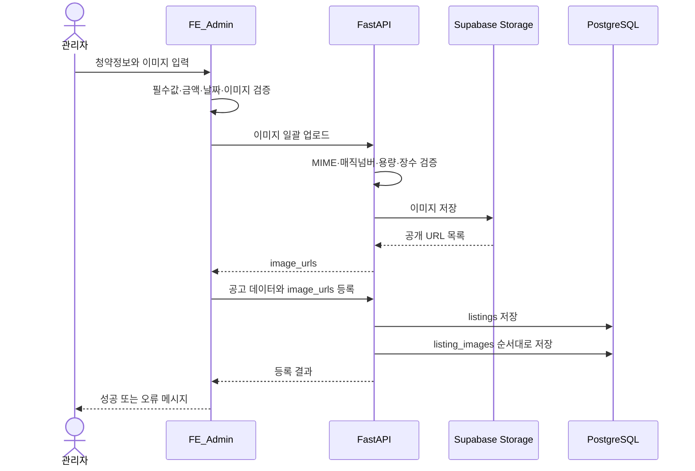
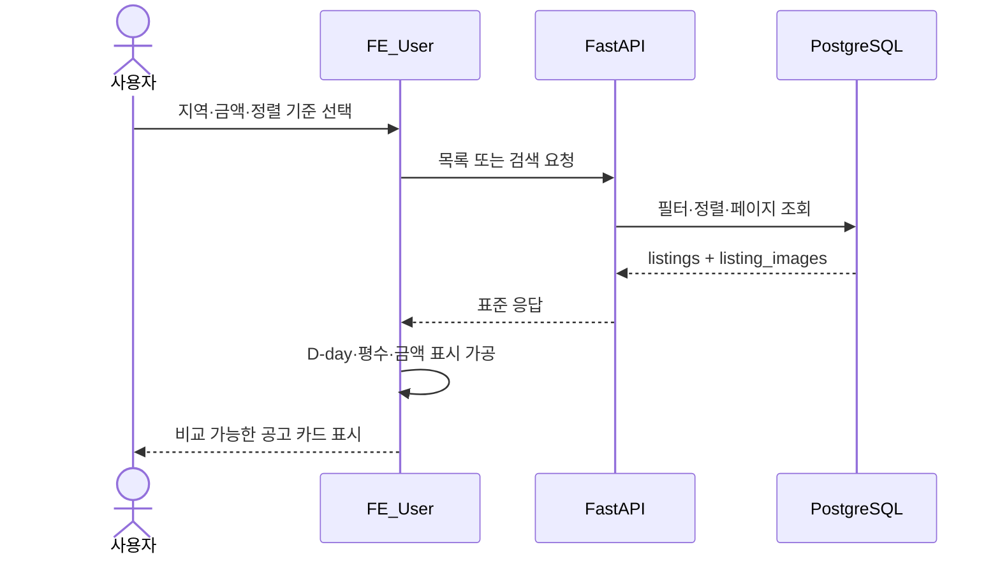
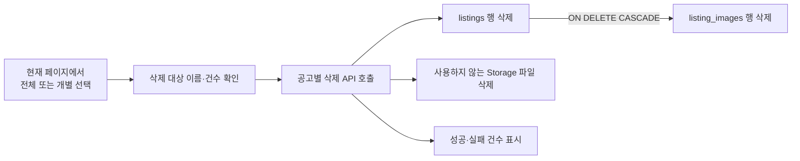

# 시스템 아키텍처

이 문서는 **수동 청약정보 등록 버전**을 기준으로 작성했습니다. Gemini 자동 등록 기능은 발표 범위에서 제외합니다.

## 1. 논리 아키텍처

### 핵심 설계

- 관리자 화면과 사용자 화면을 분리해 역할별 메뉴와 동작을 단순화했습니다.
- 모든 청약정보 데이터 처리는 FastAPI를 거치게 해 검증과 응답 형식을 통일했습니다.
- 사용자 인증은 Supabase Auth가 담당하고, 서비스 데이터는 PostgreSQL에 저장합니다.
- 이미지 파일은 Storage에 저장하고 DB에는 공개 URL과 표시 순서만 저장합니다.
- 한 공고에 여러 이미지를 연결하기 위해 `listings`와 `listing_images`를 1:N으로 설계했습니다.

## 2. 배포 구성도

아래 구성은 프로젝트의 배포 목표입니다. 실제 발표 화면에는 배포가 확인된 URL만 기입합니다.

| 구성 | 역할 | 주요 설정 |
| --- | --- | --- |
| Streamlit Community Cloud | 관리자·사용자 UI 실행 | `BACKEND_URL`, Supabase 사용자 키 |
| Render | FastAPI 백엔드 실행 | Supabase Service Role Key, 허용 Origin |
| Supabase PostgreSQL | 청약정보 및 관계 데이터 저장 | `listings`, `listing_images` 등 |
| Supabase Auth | 사용자 이메일 회원가입·로그인 | 프런트엔드에는 anon key만 사용 |
| Supabase Storage | 청약 공고 이미지 원본 저장 | Public bucket `listing-images` |

> 현재 관리자 화면의 세션 복원은 편의 기능이며 백엔드 관리자 API 인증을 대신하지 않습니다. 공개 배포 전에는 만료되는 관리자 토큰 검증이 필요합니다.

## 3. 관리자 수동 등록 흐름

## 4. 사용자 조회 흐름

## 5. 관리자 삭제 흐름

## 6. 발표에서 강조할 설계 포인트

1. 데이터베이스 정렬 후 페이지를 나누므로 페이지가 바뀌어도 전체 순서가 유지됩니다.
2. 마감된 공고는 데이터에서 삭제하지 않고 뒤로 보내 이력은 보존하면서 현재 공고를 우선합니다.
3. 이미지 행은 공고 삭제 시 Cascade로 제거하고, Storage 파일은 참조 여부를 확인한 뒤 삭제합니다.
4. 이미지 여러 장 업로드 중 하나라도 실패하면 이미 올라간 파일을 정리합니다.
5. 등록·조회·삭제 화면은 성공뿐 아니라 빈 데이터, 잘못된 입력, API 오류 상태도 표시합니다.
