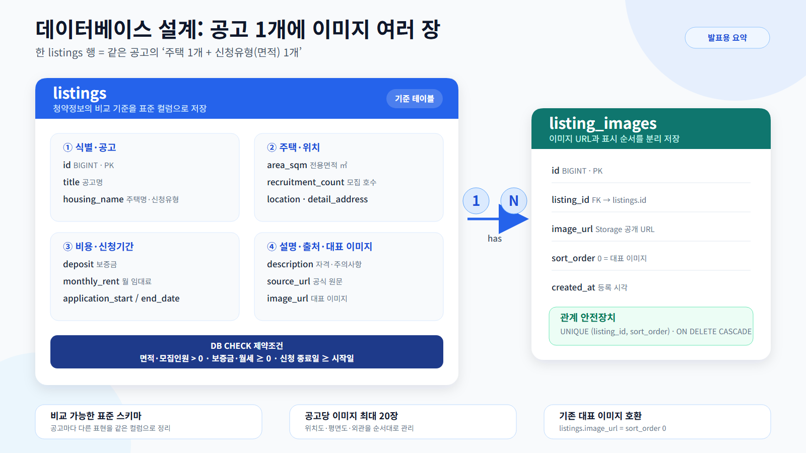

# 담당 기능 4분 발표안

## 발표 핵심 한 문장

> 저는 관리자의 청약정보 등록·조회·삭제와 사용자의 청약정보 조회를 담당했고, 공고 데이터를 비교 가능한 구조로 만들고 반복 업무와 탐색 시간을 줄이는 기능을 구현했습니다.

## 4분 시간표

| 시간 | 내용 | 보여 줄 화면 |
| --- | --- | --- |
| 0:00~0:25 | 담당 범위와 문제 | README 담당 업무 제목 |
| 0:25~1:15 | `listings`·`listing_images` 설계 | DB 관계 요약 이미지 |
| 1:15~2:35 | 사용자 조회 편의 기능 | 사용자 청약정보 조회 화면 |
| 2:35~3:25 | 관리자 등록·삭제 편의 기능 | 등록 화면과 선택 삭제 |
| 3:25~3:50 | 기술적으로 신경 쓴 부분 | DB 이미지 또는 개발 흐름 |
| 3:50~4:00 | 결과 한 문장 | 사용자 조회 화면 |

## 실제 발표 대본

### 0:00~0:25 — 담당 범위

> 저는 관리자 메뉴의 청약정보 등록과 조회·삭제, 사용자 페이지의 청약정보 조회를 담당했습니다. 기존 공고는 기관과 문서마다 표현이 달라 비교하기 어렵고, 관리자는 비슷한 주택형을 반복해서 등록해야 하는 문제가 있었습니다.

### 0:25~1:15 — 데이터베이스 핵심 설계

> 먼저 공고를 비교할 수 있도록 `listings`를 설계했습니다. 한 행은 같은 공고 안의 주택 하나와 신청유형 하나이며, 면적·모집인원·보증금·월세·신청기간을 표준 컬럼으로 저장합니다.

> 처음에는 대표 이미지 한 장만 저장했지만 위치도, 평면도, 외관을 함께 보여 주기 위해 `listing_images`를 1:N으로 분리했습니다. 첫 번째 사진은 대표 이미지이고 공고당 최대 20장까지 순서를 유지합니다. 공고 삭제 시 연결된 이미지 행도 Cascade로 정리됩니다.

### 1:15~2:35 — 사용자 조회 기능 시연

화면에서 다음 세 가지만 빠르게 보여 줍니다.

1. D-day와 마감 공고 흐림 표시
2. 보증금 낮은 순 또는 면적 넓은 순 정렬
3. 10건 단위 페이지 이동과 다중 이미지

발표 멘트:

> 사용자 화면에서는 신청 종료일까지 남은 기간을 D-day로 표시하고, 마감된 공고는 흐리게 표시해 목록 뒤로 보냈습니다. 면적은 제곱미터와 평수를 함께 보여 주고, 금액은 억·만 단위로 읽기 쉽게 바꿨습니다.

> 사용자가 원하는 조건으로 비교할 수 있도록 신청 종료일, 면적, 모집인원, 보증금, 월세 등을 기준으로 총 10가지 정렬을 구현했습니다. 정렬은 화면에 보이는 10건만 바꾸는 것이 아니라 DB에서 전체 공고를 정렬한 뒤 페이지를 나누도록 했습니다.

### 2:35~3:25 — 관리자 기능 시연

다음 두 동작만 보여 줍니다.

1. 등록 후 입력값 유지 → `입력 초기화`
2. 현재 페이지 전체 선택 → 일부 해제 → 선택 삭제 확인창

발표 멘트:

> 관리자 등록 화면은 같은 공고의 여러 주택형을 반복 등록하는 상황을 고려했습니다. 등록 후 입력값을 유지해 공통 내용을 다시 쓰지 않게 했고, 완전히 새로운 공고를 등록할 때는 초기화 버튼으로 한 번에 비울 수 있습니다.

> 조회·삭제 화면에서는 현재 페이지의 공고를 전체 또는 개별 선택해 삭제할 수 있습니다. 실수 방지를 위해 삭제 대상 이름과 건수를 확인한 뒤 처리하고, 일부 실패하면 성공과 실패 건수를 나눠 표시합니다.

### 3:25~3:50 — 기술적으로 신경 쓴 부분

> 다중 이미지에서는 DB 행과 Storage 파일이 함께 정리되도록 삭제 순서를 설계했습니다. 화면 상태는 로그인 세션과 URL 파라미터를 이용해 새로고침과 뒤로가기 후에도 복원했습니다. 모든 작업은 Issue, 기능 브랜치, PR, develop 병합 순서로 관리했습니다.

### 3:50~4:00 — 마무리

> 결과적으로 관리자는 반복 등록과 일괄 정리 시간을 줄이고, 사용자는 마감일과 비용을 기준으로 청약 공고를 더 빠르게 비교할 수 있게 했습니다.

## 반드시 말할 내용

- 담당 범위 3개 화면
- `listings` 표준화
- `listing_images` 1:N과 최대 20장
- D-day·마감 후순위·10가지 정렬
- 등록값 유지와 선택 삭제
- DB 정렬 후 페이지 처리

## 시간이 부족하면 뺄 내용

- 전체 시스템 아키텍처 설명
- 모든 테이블 컬럼 이름
- 전체 API 목록
- SQL 전문
- PR 번호 나열
- 이미지 MIME·용량 제한의 세부 수치
- 자동 등록 기능과 향후 계획

## 4분 시연 준비

- [ ] D-DAY 또는 D-3 공고 1건
- [ ] 마감된 공고 1건
- [ ] 금액·면적 차이가 큰 공고 여러 건
- [ ] 이미지 3장 이상인 공고 1건
- [ ] 총 11건 이상으로 2페이지 준비
- [ ] 삭제용 가짜 공고 2건
- [ ] 등록 화면에는 반복 입력할 값 미리 준비
- [ ] 시연이 느릴 때 사용할 90초 녹화 영상 준비
