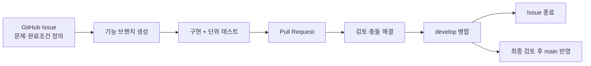

# 업무 설명 — 청약정보 등록·조회·삭제

> 발표 시간이 4분이면 [담당 기능 4분 발표안](work-presentation-4min.md)을 사용합니다.

## 1. 담당 범위

- 관리자 `청약정보 등록`
- 관리자 `청약정보 조회/삭제`
- 사용자 `청약정보 조회`
- 위 화면을 지원하는 `listings`, `listing_images`, 이미지 Storage 및 관련 API

즐겨찾기, 생활권 분석, AI 상담·안내원은 이 업무 설명에서 제외합니다.

## 2. 작업 내용과 해결한 문제

| 작업 | 문제 | 구현 내용 | 사용자 가치 |
| --- | --- | --- | --- |
| `listings` 설계 | 공고별 필수 정보가 일정하지 않음 | 주택 1개와 신청유형 1개를 한 행으로 정규화 | 공고 간 조건 비교 가능 |
| 다중 이미지 | 대표 이미지 한 장만 저장 가능 | `listing_images` 1:N 테이블과 Storage 연동, 최대 20장 | 위치도·평면도·외관을 함께 확인 |
| 마감 정보 | 신청 기한을 직접 계산해야 함 | D-day, 마감 임박순, 마감 공고 흐림·후순위 | 신청 가능한 공고 우선 확인 |
| 페이지 조회 | 공고가 많으면 긴 화면을 계속 스크롤 | 페이지당 10건, 잘못된 페이지 자동 보정 | 탐색 부담 감소 |
| 면적 표시 | 제곱미터만으로 크기 체감이 어려움 | `㎡`와 약식 `평` 병기 | 면적 이해 개선 |
| 금액 표시 | 긴 원 단위 숫자를 읽기 어려움 | 쉼표와 억·만 단위 설명 | 입력·조회 오류 감소 |
| 다양한 정렬 | 한 가지 순서로는 사용자 조건 반영 어려움 | 면적·인원·보증금·월세 양방향 등 10개 기준 | 사용자 목적에 맞는 비교 |
| 등록 폼 상태 | 비슷한 주택형 반복 등록 시 재입력 | 등록 후 값 유지, 명시적 초기화 | 관리자 반복 업무 단축 |
| 화면 상태 복원 | 새로고침·뒤로가기 시 작업 위치 손실 | Session Storage와 URL Query Parameter 활용 | 작업 연속성 개선 |
| 일괄 삭제 | 공고를 한 건씩 삭제해야 함 | 현재 페이지 전체 선택·선택 삭제·확인창 | 관리자 정리 시간 단축 |

## 3. 데이터 품질을 지킨 방법

- Pydantic과 DB Check Constraint에서 면적·인원·금액·신청기간을 이중 검증했습니다.
- 한 공고의 사진 순서는 `sort_order`로 고정했습니다.
- 첫 이미지와 `listings.image_url`을 대표 이미지로 맞춰 기존 화면 호환성을 유지했습니다.
- 삭제 전에 이미지 URL을 확보한 뒤 DB와 Storage를 순서대로 정리했습니다.
- 다른 공고가 같은 Storage 파일을 참조하면 실제 파일을 삭제하지 않도록 확인합니다.
- 잘못된 이미지 확장자를 막기 위해 MIME과 실제 파일의 매직넘버를 함께 검사합니다.

## 4. 개발 방식

- `main`은 직접 수정하지 않았습니다.
- 기능 단위로 Issue → Branch → PR → `develop` Merge → Issue 종료 순서를 지켰습니다.
- 최종 발표·배포 검토가 끝난 뒤 `develop`을 `main`에 반영하는 전략입니다.

## 5. 대표 PR

| PR | 내용 |
| --- | --- |
| [#11](https://github.com/kiwi248/aio-01-p1-team1/pull/11) | 청약정보 구조와 서울 자치구 입력 정리 |
| [#22](https://github.com/kiwi248/aio-01-p1-team1/pull/22) | 이미지 업로드 |
| [#23](https://github.com/kiwi248/aio-01-p1-team1/pull/23) | 공고 삭제 시 Storage 이미지 정리 |
| [#31](https://github.com/kiwi248/aio-01-p1-team1/pull/31) | 사용자 로그인 세션 복원 |
| [#40](https://github.com/kiwi248/aio-01-p1-team1/pull/40) | 관리자 등록 폼 유지·초기화 |
| [#42](https://github.com/kiwi248/aio-01-p1-team1/pull/42) | 면적 평수 표시 |
| [#47](https://github.com/kiwi248/aio-01-p1-team1/pull/47) | D-day와 마감 공고 정렬 |
| [#49](https://github.com/kiwi248/aio-01-p1-team1/pull/49) | 사용자 목록 페이지네이션 |
| [#54](https://github.com/kiwi248/aio-01-p1-team1/pull/54) | 금액 가독성 개선 |
| [#58](https://github.com/kiwi248/aio-01-p1-team1/pull/58) | 관리자·사용자 조회 가독성 개선 |
| [#60](https://github.com/kiwi248/aio-01-p1-team1/pull/60) | 청약정보 정렬 기준 확장 |
| [#68](https://github.com/kiwi248/aio-01-p1-team1/pull/68) | 다중 이미지 업로드·조회 |
| [#75](https://github.com/kiwi248/aio-01-p1-team1/pull/75) | Streamlit 시작 오류 수정 |
| [#79](https://github.com/kiwi248/aio-01-p1-team1/pull/79) | 청약정보 선택·일괄 삭제 |

## 6. 발표용 업무 설명 예시

> 저는 관리자 청약정보 등록과 조회·삭제, 사용자 청약정보 조회를 담당했습니다. 먼저 공고마다 표현이 다른 정보를 비교할 수 있도록 `listings` 스키마를 정의했습니다. 사진 한 장만으로는 주택 정보를 충분히 전달하기 어려워 `listing_images`와 Supabase Storage를 연결해 공고당 최대 20장을 순서대로 관리하도록 확장했습니다. 사용자 화면에는 D-day, 마감 공고 후순위 처리, 10가지 정렬, 페이지네이션, 평수와 읽기 쉬운 금액 표시를 적용했습니다. 관리자 화면에는 반복 등록을 위한 입력 유지·초기화와 현재 페이지 선택 삭제를 추가했습니다. 모든 작업은 Issue, 기능 브랜치, PR, develop 병합 순서로 관리했습니다.

## 7. 배운 점

- 화면 편의 기능도 데이터 정렬 위치와 상태 저장 위치를 잘못 고르면 결과가 달라질 수 있습니다.
- 여러 이미지는 단순 배열보다 1:N 테이블이 개별 삭제와 순서 관리에 적합했습니다.
- DB 행 삭제와 Storage 파일 삭제는 트랜잭션 범위가 달라 실행 순서와 실패 복구가 중요했습니다.
- 페이지네이션은 프런트가 아닌 DB 조회 단계에서 정렬과 함께 처리해야 전체 순서가 유지됩니다.
