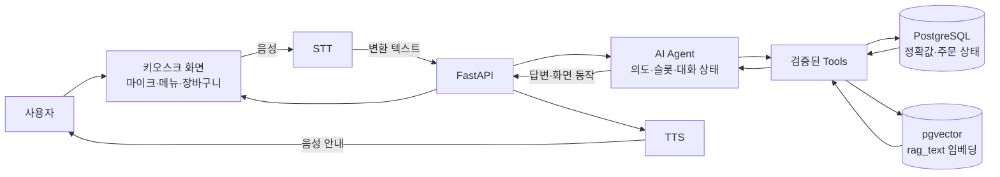

# 햄버거 음성 키오스크 팀 프로젝트 마스터플랜

## 1. 프로젝트 개요

### 1.1 목표

사용자가 화면의 마이크 버튼을 누르고 자연스럽게 말하면 AI가 주문 의도와 조건을 이해하고, 실제 메뉴 데이터에서 검색한 뒤 장바구니 조작·주문 확인·음성 안내까지 수행하는 햄버거 키오스크를 만든다.

예시 발화:

- “만원 안에서 안 매운 버거 세트 추천해 줘.”
- “불고기 버거 하나 담고 감자튀김은 치즈스틱으로 바꿔 줘.”
- “새우 알레르기가 있는데 먹을 수 있는 메뉴가 뭐야?”
- “방금 담은 음료를 콜라 라지로 바꿔 줘.”

### 1.2 핵심 설계 원칙

1. 가격, 재고, 옵션, 수량처럼 틀리면 안 되는 값은 PostgreSQL의 구조화된 컬럼에서 조회한다.
2. “담백한 메뉴”, “든든한 메뉴”처럼 의미가 필요한 추천은 `rag_text`와 pgvector를 사용한다.
3. AI는 가격을 계산하거나 주문을 직접 변경하지 않고, 검증된 Tool을 호출한다.
4. 알레르기 정보가 불명확하면 안전하다고 단정하지 않는다.
5. 결제 직전에는 메뉴, 옵션, 수량, 총액을 화면과 음성으로 다시 확인한다.

## 2. MVP 범위

### 포함

- 햄버거·사이드·음료 메뉴 각 3개 이상, 세트와 옵션
- 마이크 버튼, 녹음 상태, STT 변환 문장 표시 및 수정
- 주문·추천·메뉴 질문·장바구니 수정 의도 처리
- 정확 조건 검색(SQL)과 의미 검색(pgvector)을 합친 Hybrid RAG
- 장바구니 추가·변경·삭제·조회·총액 계산
- 알레르기 경고와 주문 최종 확인
- 화면 응답과 TTS 재생
- STT 실패, 품절, 모호한 주문의 재질문

### 제외 또는 모의 처리

- 실제 카드 결제와 영수증 프린터 연동
- 회원·쿠폰·배달 기능
- 다국어와 매장별 실시간 재고 시스템
- 완전한 무인 운영(직원 호출은 버튼 또는 모의 기능)

## 3. 전체 아키텍처



처리 순서: 음성 수집 → STT → 의도/슬롯 추출 → 필요한 Tool 호출 → DB/RAG 결과 확인 → 답변 및 화면 갱신 → TTS. LLM은 검색된 메뉴에 없는 정보는 만들지 않는다.

## 4. 주요 영역 1: 화면에서 음성으로 주문

### 4.1 권장 화면 구성

- 상단: 현재 단계, 음성/네트워크 상태, 처음으로, 직원 호출
- 중앙: 추천·검색된 메뉴 카드(이름, 이미지, 가격, 알레르기, 품절)
- 하단 고정: 마이크 버튼, “듣는 중” 애니메이션, STT 문장, 다시 말하기
- 우측 또는 별도 화면: 장바구니, 옵션, 수량, 총액, 주문 확인
- 접근성: 큰 글씨, 높은 대비, 버튼 터치 영역 최소 44px, 음성과 동일한 화면 문구

### 4.2 상태 흐름

| 상태                 | 화면                       | 시스템 행동                |
| -------------------- | -------------------------- | -------------------------- |
| `IDLE`               | “마이크를 눌러 주문하세요” | 대기                       |
| `LISTENING`          | 파형과 중지 버튼           | 음성 녹음, 최대 시간 제한  |
| `TRANSCRIBING`       | “말씀을 확인하고 있어요”   | STT 호출                   |
| `UNDERSTANDING`      | 변환 문장 표시             | 의도·슬롯 추출, Tool 결정  |
| `NEED_CLARIFICATION` | 선택 후보 또는 질문        | 메뉴/수량/옵션 재질문      |
| `CART_UPDATED`       | 변경된 장바구니 강조       | 성공 결과와 총액 안내      |
| `CONFIRMING`         | 전체 주문 요약             | 명시적 예/아니요 입력 대기 |
| `COMPLETED`          | 주문번호                   | 모의 결제 완료             |
| `ERROR`              | 오류 원인과 재시도         | 상태를 보존하고 재시도     |

### 4.3 의도와 슬롯

초기 의도는 `ORDER_ITEM`, `RECOMMEND_MENU`, `MENU_QA`, `UPDATE_CART`, `REMOVE_ITEM`, `GET_CART`, `CONFIRM_ORDER`, `CANCEL`, `UNKNOWN`으로 제한한다.

주요 슬롯:

```json
{
  "intent": "ORDER_ITEM",
  "menu_name": "불고기 버거",
  "quantity": 1,
  "size": null,
  "set": true,
  "options": {"side": "치즈스틱", "drink": "콜라"},
  "constraints": {
    "max_price": null,
    "spiciness_max": null,
    "excluded_ingredients": [],
    "allergies": []
  },
  "confidence": 0.94
}
```

신뢰도가 낮거나 후보가 여러 개면 주문을 추측하지 말고 “불고기 버거와 더블 불고기 버거 중 어떤 메뉴인가요?”처럼 재질문한다.

### 4.4 오류와 재시도

- 무음/소음: “잘 듣지 못했어요. 마이크 가까이에서 다시 말씀해 주세요.”
- STT 오인식: 변환 문장을 화면에 보여 주고 수정 또는 다시 말하기 제공
- 메뉴 불일치: 비슷한 후보 최대 3개 제시
- 품절: 장바구니에 넣지 않고 대체 메뉴 제시
- API/네트워크 오류: 장바구니와 대화 상태를 유지한 채 재시도
- TTS 실패: 화면 답변은 유지하고 다시 듣기 버튼 제공
- 중복 요청: `request_id`로 같은 장바구니 변경의 재실행 방지

## 5. 주요 영역 2: RAG 데이터 기획

### 5.1 정확한 DB 필드와 의미 RAG 텍스트 구분

| 종류              | 저장 예                                                               | 사용 방식                                     |
| ----------------- | --------------------------------------------------------------------- | --------------------------------------------- |
| 정확값            | 메뉴 코드, 이름, 가격, 판매 여부, 옵션 추가금, 재고, 알레르기, 원재료 | SQL 필터·검증·계산                            |
| 의미 정보         | 달콤함, 담백함, 든든함, 추천 대상, 메뉴 특징, 자연어 FAQ              | 임베딩 유사도 검색                            |
| 둘 다 필요한 정보 | 맛, 매운맛, 재료, 알레르기                                            | DB에는 표준값, `rag_text`에는 자연스러운 설명 |

가격이나 판매 여부를 `rag_text`에만 저장하면 오래된 검색 결과로 잘못 주문할 수 있다. 답변을 만들 때 가격·재고는 항상 DB의 현재 값을 우선한다.

### 5.2 메뉴 필드 계획

`menu_items` 핵심 필드:

- 식별: `id`, `menu_code`, `name`, `category`
- 판매: `price`, `available`, `stock_status`, `display_order`
- 설명: `description`, `image_url`
- 음식 특성: `ingredients[]`, `allergens[]`, `taste_tags[]`, `spiciness_level`(0~5), `calories`
- 추천: `recommendation_tags[]`, `not_recommended_for[]`
- RAG: `rag_text`, `embedding`, `embedding_model`, `content_version`, `updated_at`

추가 엔터티:

- `option_groups`, `options`: 치즈 추가, 패티 추가, 사이즈업, 사이드·음료 교체와 추가금
- `set_menus`, `set_components`: 버거+사이드+음료 조합과 허용 교체
- `faq_documents`: 포장, 결제 방법, 영업시간, 알레르기 안내
- `carts`, `cart_items`, `cart_item_options`: 세션별 장바구니
- `orders`, `order_items`: 확인된 주문 스냅샷
- `conversation_sessions`: 현재 단계, 최근 의도, 보류 중 확인 항목

### 5.3 `rag_text` 작성 규칙과 예시

한 문서에는 한 메뉴 또는 한 FAQ만 담는다. 이름, 특징, 맛, 추천 대상, 비추천 조건을 자연어로 포함하되 변동이 잦은 가격·재고는 검색 필터용 DB 값을 신뢰한다.

```text
문서 유형: 메뉴
메뉴명: 불고기 버거
카테고리: 햄버거
특징: 소고기 패티와 달콤하고 짭짤한 불고기 소스를 사용합니다.
맛: 달콤함, 짭짤함, 맵지 않음.
주요 재료: 소고기 패티, 양상추, 양파, 불고기 소스.
알레르기 유발 가능 성분: 밀, 대두.
추천: 달콤한 맛이나 맵지 않은 버거를 원하는 고객에게 적합합니다.
```

### 5.4 Hybrid RAG 검색 전략

1. Agent가 `max_price`, `category`, `available`, 알레르기 제외 등의 필터를 추출한다.
2. SQL로 조건에 맞지 않는 메뉴를 먼저 제외한다.
3. “담백하고 든든한” 같은 질의는 남은 후보의 벡터 유사도를 계산한다.
4. 텍스트 일치/인기도/벡터 점수를 합쳐 상위 3개만 반환한다.
5. 알레르기와 품절을 마지막에 다시 검증한다.

예: “만원 이하에서 안 매운 버거”는 `price <= 10000`, `available = true`, `spiciness_level <= 1`을 SQL로 처리하고, 취향 표현이 추가된 경우에만 의미 점수를 결합한다.

### 5.5 샘플 테이블

```sql
CREATE EXTENSION IF NOT EXISTS vector;

CREATE TABLE menu_items (
  id BIGSERIAL PRIMARY KEY,
  menu_code VARCHAR(50) UNIQUE NOT NULL,
  name VARCHAR(100) NOT NULL,
  category VARCHAR(30) NOT NULL,
  price INTEGER NOT NULL CHECK (price >= 0),
  description TEXT NOT NULL,
  ingredients TEXT[] NOT NULL DEFAULT '{}',
  allergens TEXT[] NOT NULL DEFAULT '{}',
  taste_tags TEXT[] NOT NULL DEFAULT '{}',
  recommendation_tags TEXT[] NOT NULL DEFAULT '{}',
  spiciness_level SMALLINT NOT NULL DEFAULT 0 CHECK (spiciness_level BETWEEN 0 AND 5),
  available BOOLEAN NOT NULL DEFAULT TRUE,
  rag_text TEXT NOT NULL,
  embedding VECTOR(768), -- 선택한 임베딩 모델 차원과 반드시 일치
  embedding_model VARCHAR(100),
  content_version INTEGER NOT NULL DEFAULT 1,
  updated_at TIMESTAMPTZ NOT NULL DEFAULT NOW()
);

CREATE INDEX menu_filter_idx
  ON menu_items (category, available, price);
```

운영 단계에서는 벡터 인덱스(HNSW 등)를 추가하고, 메뉴 변경 시 `content_version`을 올린 뒤 해당 문서만 재임베딩한다.

## 6. 주요 영역 3: Agent Tool 추가

Tool 입력과 출력은 JSON Schema로 검증한다. 모든 변경 Tool은 `session_id`와 `request_id`를 받고, 서버가 메뉴·가격·옵션을 다시 검증한다.

| Tool               | 주요 입력                           | 주요 출력                | 사용 시점                       |
| ------------------ | ----------------------------------- | ------------------------ | ------------------------------- |
| `menu_search`      | `query`, `category`, `top_k`        | 후보 메뉴와 근거         | 취향·특징 기반 추천/FAQ         |
| `menu_filter`      | 가격, 맵기, 재료 제외, 판매 여부    | 정확 조건 후보           | “8천 원 이하”, “치즈 없는” 질문 |
| `add_to_cart`      | 메뉴 코드, 수량, 옵션               | 추가 항목, 장바구니 버전 | 메뉴·옵션이 확정된 뒤           |
| `update_cart`      | 항목 ID, 수량/옵션                  | 변경 항목, 새 총액       | “두 개로”, “콜라로 바꿔”        |
| `remove_from_cart` | 항목 ID 또는 명확한 대상            | 삭제 결과, 새 총액       | 삭제 의도 확인 후               |
| `get_cart`         | 세션 ID                             | 전체 항목, 총액          | 조회 또는 확인 전               |
| `calculate_total`  | 세션 ID                             | 기본가, 옵션가, 합계     | 표시/최종 확인 시               |
| `check_allergy`    | 메뉴 코드들, 알레르기 목록          | 위험/불명확 성분과 근거  | 추천 후, 담기 전, 확인 전       |
| `order_confirm`    | 세션 ID, 장바구니 버전, 사용자 확인 | 주문 ID/번호, 최종 금액  | 명시적 최종 동의 후 한 번만     |

대표 계약 예시:

```json
{
  "tool": "menu_filter",
  "input": {
    "category": "burger",
    "max_price": 8000,
    "max_spiciness": 1,
    "exclude_allergens": ["새우"],
    "available_only": true
  },
  "output": {
    "items": [
      {"menu_code": "BURGER001", "name": "불고기 버거", "price": 6500}
    ],
    "applied_filters": ["price<=8000", "spiciness<=1", "available=true"]
  }
}
```

Tool 공통 오류 코드는 `NOT_FOUND`, `AMBIGUOUS_ITEM`, `SOLD_OUT`, `INVALID_OPTION`, `ALLERGY_WARNING`, `STALE_CART`, `SYSTEM_ERROR`로 통일한다. 변경 이력에는 입력, 결과, 시간, 세션을 기록하되 원본 음성 등 개인정보는 최소화한다.

## 7. 주요 영역 4: AI Agent 추가

### 7.1 책임과 경계

Agent의 책임:

- 발화에서 의도, 메뉴, 수량, 옵션, 예산, 취향, 알레르기를 추출
- 정확 필터, RAG 검색, 장바구니 Tool 중 필요한 경로 선택
- Tool 결과를 근거로 짧고 이해하기 쉬운 답변 작성
- 부족한 필수 슬롯을 한 번에 하나씩 재질문
- 대화 상태와 대명사(“그거”, “방금 메뉴”)를 현재 장바구니에 연결
- 주문 변경 후 화면과 음성으로 결과 확인

Agent가 하면 안 되는 일:

- 가격·총액을 임의 계산하거나 DB에 직접 쓰기
- 메뉴에 없는 재료·알레르기 정보를 추측하기
- 품절 메뉴를 담거나 명시적 확인 없이 주문 확정하기

### 7.2 라우팅 기준

- 정확 조건만 있음 → `menu_filter`
- 취향/자연어 추천 → `menu_search`(필요하면 필터 병행)
- 주문 변경 → 먼저 대상과 옵션을 해석하고 장바구니 Tool
- 알레르기 언급 → 추천과 담기 전 `check_allergy` 필수
- FAQ → `faq_documents` RAG 검색
- 주문 확정 → `get_cart`와 `calculate_total` 후 사용자 동의, 그다음 `order_confirm`

### 7.3 대화 상태

```json
{
  "session_id": "kiosk-01-session-123",
  "stage": "BUILDING_CART",
  "last_intent": "ORDER_ITEM",
  "active_cart_item_id": "ci_8",
  "pending_action": null,
  "known_allergies": ["새우"],
  "cart_version": 4,
  "last_recommendation_codes": ["BURGER001", "BURGER003"]
}
```

세션 종료, 일정 시간 무응답, 주문 완료 시 상태를 초기화한다. 알레르기처럼 민감할 수 있는 정보는 세션 범위에서만 보관한다.

### 7.4 샘플 흐름

1. 사용자: “만원 안쪽으로 안 매운 세트 추천해 줘. 새우 알레르기가 있어.”
2. Agent: 의도 `RECOMMEND_MENU`, 예산 10,000원, 맵기 1 이하, 알레르기 새우 추출.
3. `menu_filter`와 필요 시 `menu_search` 호출.
4. `check_allergy`로 후보 재검증.
5. Agent: “불고기 버거 세트가 조건에 맞아요. 현재 가격은 9,500원이며, 등록 정보상 새우 알레르기 성분은 없지만 교차접촉 가능성은 매장 안내를 확인해 주세요. 담을까요?”
6. 사용자: “응, 콜라는 제로 콜라로.”
7. `add_to_cart` 호출 후 화면 갱신.
8. Agent: “불고기 버거 세트 1개, 제로 콜라로 담았습니다. 총 9,500원입니다.”
9. 사용자: “주문할게.”
10. `get_cart`와 `calculate_total` 호출 후 전체 내역을 읽고 “이대로 주문할까요?”라고 최종 확인.
11. 사용자가 “네”라고 답한 뒤에만 `order_confirm` 호출.

## 8. 권장 기술 스택

| 영역             | 권장 기술                                           | 선택 이유                        |
| ---------------- | --------------------------------------------------- | -------------------------------- |
| 프론트엔드       | React + TypeScript + Vite                           | 상태 기반 UI와 팀 개발이 쉬움    |
| 음성 수집        | Web Audio/MediaRecorder API                         | 브라우저에서 녹음 가능           |
| 백엔드           | Python 3.12 + FastAPI + Pydantic                    | AI 연동과 JSON 검증에 적합       |
| DB               | PostgreSQL + pgvector                               | 관계형 필터와 벡터 검색 통합     |
| ORM/마이그레이션 | SQLAlchemy + Alembic                                | 스키마 변경 관리                 |
| STT/TTS          | 초기에는 클라우드 API 또는 로컬 Whisper/TTS 중 택일 | 환경·예산에 따라 교체 가능       |
| LLM/임베딩       | Ollama 또는 팀이 승인한 API                         | 로컬 시연 가능, 모델명·차원 기록 |
| 테스트           | Pytest, Vitest, Playwright                          | 단위·API·E2E 분리                |
| 실행             | Docker Compose                                      | 팀원 환경 통일                   |

처음부터 여러 모델을 지원하기보다 STT, LLM, 임베딩, TTS를 각각 인터페이스로 감싸 한 구현으로 MVP를 완성한다.

## 9. API 설계

| Method   | Endpoint                                  | 역할                                |
| -------- | ----------------------------------------- | ----------------------------------- |
| `POST`   | `/api/sessions`                           | 키오스크 대화/장바구니 세션 생성    |
| `POST`   | `/api/voice/transcribe`                   | 음성 파일을 텍스트로 변환           |
| `POST`   | `/api/agent/messages`                     | 텍스트 입력 처리, 답변·UI 명령 반환 |
| `GET`    | `/api/menus`                              | 정확 조건 메뉴 조회                 |
| `GET`    | `/api/menus/{menu_code}`                  | 상세·옵션·알레르기 조회             |
| `POST`   | `/api/search`                             | Hybrid RAG 검색(개발/내부용)        |
| `GET`    | `/api/carts/{session_id}`                 | 장바구니 조회                       |
| `POST`   | `/api/carts/{session_id}/items`           | 항목 추가                           |
| `PATCH`  | `/api/carts/{session_id}/items/{item_id}` | 수량·옵션 변경                      |
| `DELETE` | `/api/carts/{session_id}/items/{item_id}` | 항목 삭제                           |
| `POST`   | `/api/orders/confirm`                     | 최종 확인된 주문 생성               |
| `POST`   | `/api/voice/synthesize`                   | 답변을 음성으로 변환                |

`/api/agent/messages` 응답에는 `reply_text`, `tts_text`, `intent`, `ui_action`, `cart`, `requires_confirmation`, `trace_id`를 포함한다. 운영 화면에 내부 프롬프트나 원시 Tool 오류를 노출하지 않는다.

## 10. 구현 단계와 산출물

### 0단계: 합의와 기준 데이터

- MVP 메뉴, 옵션, 알레르기 표준어, 성공 시나리오 확정
- 산출물: 와이어프레임, 메뉴 CSV/JSON, API 계약 초안

### 1단계: DB와 메뉴 API

- 마이그레이션, 샘플 데이터, 메뉴/옵션/세트 조회 구현
- 산출물: ERD, SQL 마이그레이션, API 테스트

### 2단계: 화면과 장바구니

- 메뉴 카드, 장바구니, 옵션, 총액, 세션 구현
- 산출물: 터치 주문이 가능한 기본 키오스크

### 3단계: STT/TTS

- 녹음, 변환 문장 수정, 다시 듣기, 실패 재시도 구현
- 산출물: 음성 입력과 출력 데모

### 4단계: RAG와 Agent Tools

- 임베딩 파이프라인, Hybrid 검색, Tool 스키마와 검증 구현
- 산출물: 추천·필터·장바구니 Tool 자동 테스트

### 5단계: Agent와 안전 장치

- 의도 라우팅, 슬롯 확인, 대화 상태, 알레르기/최종 확인 구현
- 산출물: 핵심 E2E 시나리오 통과

### 6단계: 통합·시연 준비

- 소음/지연/오류 테스트, 로그, 초기화, Docker 실행, 발표 시나리오
- 산출물: 실행 가이드, 테스트 보고서, 데모 영상 또는 시연 체크리스트

## 11. 팀 업무 분담 예시

| 역할              | 주요 업무                                  | 연결 지점                |
| ----------------- | ------------------------------------------ | ------------------------ |
| PM/기획·QA        | MVP, 대화 시나리오, 메뉴 데이터, 인수 기준 | 모든 역할의 계약 관리    |
| 프론트엔드        | 화면 상태, 녹음, 장바구니 UI, 접근성       | Agent 응답의 `ui_action` |
| 백엔드            | API, 세션, 장바구니, 주문, 검증            | DB와 Tool 구현           |
| AI/RAG            | 전처리·임베딩, 검색 평가, 의도/슬롯, Agent | Tool 계약과 안전 규칙    |
| 인프라(겸임 가능) | Docker, 환경 변수, 로그, 배포              | 재현 가능한 시연 환경    |

작은 팀이라면 프론트엔드 1명, 백엔드/DB 1명, AI/RAG 1명으로 나누고 PM·QA·인프라는 공동 담당한다. API와 Tool의 JSON 예시를 먼저 합의해 병렬 개발한다.

## 12. 테스트 시나리오와 통과 기준

| 번호 | 시나리오                                 | 기대 결과                                 |
| ---- | ---------------------------------------- | ----------------------------------------- |
| T01  | “불고기 버거 하나 줘”                    | 정확한 메뉴 1개 추가, 총액 일치           |
| T02  | “8천 원 이하 안 매운 버거”               | SQL 조건을 모두 만족하는 판매 메뉴만 표시 |
| T03  | “담백하고 가벼운 거 추천해 줘”           | RAG 근거가 있는 후보 최대 3개 제시        |
| T04  | “새우 알레르기가 있어” 후 새우 버거 요청 | 경고 후 자동 추가 금지, 대체 메뉴 제시    |
| T05  | “그거 두 개로 바꿔 줘”                   | 최근 활성 항목이 명확할 때만 수량 변경    |
| T06  | 동명/유사 메뉴 주문                      | 후보를 보여 주고 재질문, 임의 선택 금지   |
| T07  | 품절 메뉴 주문                           | 추가하지 않고 품절 및 대안 안내           |
| T08  | 같은 요청 재전송                         | `request_id`로 한 번만 반영               |
| T09  | STT가 잘못 변환됨                        | 문장 수정/재녹음 가능, 기존 장바구니 유지 |
| T10  | “주문할게”                               | 전체 내역·총액을 다시 확인한 뒤 확정      |
| T11  | DB와 `rag_text`의 가격이 다름            | DB 현재 가격으로 응답 및 계산             |
| T12  | API 장애/시간 초과                       | 친절한 오류, 재시도, 세션 상태 보존       |

추가 측정 지표: STT 핵심 슬롯 정확도, 의도 정확도, 검색 Top-3 적합률, Tool 성공률, 잘못된 장바구니 변경 0건, 평균 응답 시간. MVP 목표치는 팀의 장비와 모델을 측정한 뒤 수치로 확정한다.

## 13. 완료 체크리스트

### 기획·데이터

- [ ] MVP 메뉴·세트·옵션·FAQ 데이터가 확정되었다.
- [ ] 정확 DB 필드와 `rag_text`의 책임이 구분되었다.
- [ ] 알레르기·재료·맛 태그 표준어가 정해졌다.
- [ ] 임베딩 모델과 벡터 차원이 기록되었다.

### 화면·음성

- [ ] 녹음, 처리 중, 재질문, 오류, 확인 상태가 화면에 보인다.
- [ ] STT 문장을 사용자가 확인·수정할 수 있다.
- [ ] 모든 핵심 응답이 화면과 TTS로 함께 제공된다.
- [ ] 세션 초기화와 직원 호출이 동작한다.

### Tool·Agent

- [ ] 9개 Tool의 입력/출력 스키마와 오류 코드가 검증된다.
- [ ] Agent가 SQL 검색과 의미 검색을 올바르게 구분한다.
- [ ] 장바구니 변경은 Tool만 수행하고 중복 요청을 방지한다.
- [ ] 알레르기와 품절을 추천·추가·확정 전에 검사한다.
- [ ] 주문은 명시적 최종 확인 후 한 번만 생성된다.

### 품질·시연

- [ ] T01~T12가 자동 또는 수동 테스트로 통과했다.
- [ ] 메뉴에 없는 정보를 만들어내는 답변이 없다.
- [ ] 새 PC에서 문서대로 실행할 수 있다.
- [ ] 장애가 나도 장바구니가 불필요하게 사라지지 않는다.
- [ ] 발표용 정상 흐름과 오류 복구 흐름을 모두 시연할 수 있다.

## 14. 첫 스프린트 권장 작업

1. 메뉴 12~20개, 사이드·음료·옵션·FAQ를 JSON 또는 CSV로 확정한다.
2. PostgreSQL 테이블과 마이그레이션을 만들고 샘플 데이터를 넣는다.
3. `menu_filter`, `get_cart`, `add_to_cart`, `calculate_total`을 먼저 구현한다.
4. 음성 없이 텍스트 입력으로 한 개의 전체 주문 흐름을 완성한다.
5. 이후 STT/TTS와 RAG 추천을 붙이고, 마지막에 Agent 자동 라우팅을 연결한다.

이 순서를 따르면 음성·LLM이 아직 불안정해도 팀은 DB, 장바구니, 화면을 독립적으로 검증할 수 있고, 최종적으로 “자연어를 이해하지만 주문 결과는 검증된 데이터와 Tool로 통제되는 키오스크”를 완성할 수 있다.
