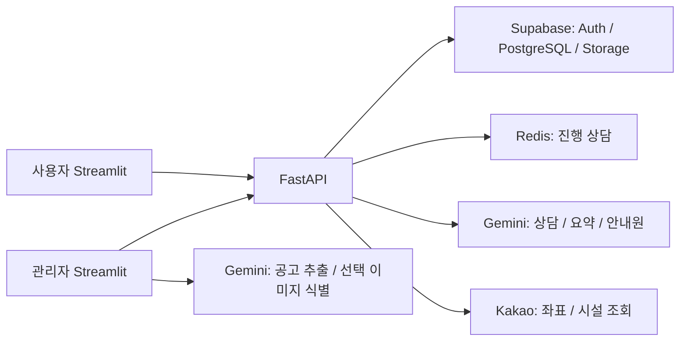

# 공공임대 및 분양 청약 통합 안내 서비스

교육 과정의 팀 프로젝트를 출발점으로, 로컬에서 실행하고 시연할 수 있는 개인 포트폴리오로 개선한 서비스입니다. 관리자는 문서에서 공고를 추출·검토해 등록하고, 사용자는 공고 검색·즐겨찾기·상담을 이용합니다. 개인 리팩토링에서는 저장 실패, 동시 요청, AI 출력 검증, 외부 호출 제한과 성능 측정을 중심으로 개선했습니다. 팀 개발 이력은 Git에 유지하며 개인 개선은 한글 Issue·PR로 기록합니다.

현재 구현은 **FastAPI 서비스 + Pydantic 계약 + 명시적 실행 분기**입니다. 별도 Agent registry, LangGraph 또는 MCP 서버를 구현한 프로젝트로 소개하지 않습니다. 실제 모델 평가와 공개 배포는 후속 과제입니다.

## 구현한 기능

| 화면 | 기능 |
|---|---|
| 사용자 | 이메일 로그인·복원, 자치구/최대 보증금/최대 월세 검색, 페이지 이동, 공고 상세·사진, 즐겨찾기, 프로필 수정 |
| 상담 | 사용자별 Redis 문맥, Gemini 또는 명시적 mock, 요약 저장·재시도 복구, 새로고침 후 진행 대화 복원 |
| 안내원 | 사이트 사용법의 고정 단계, 간단한 용어·계산, 서비스 범위 밖 요청 거절 |
| 관리자 | 로그인, 수동·문서 기반 공고 등록, 추출 결과 검토·누락값 보정, 공고·사진 수정·삭제, 즐겨찾기 순위·로그 조회 |
| 생활권 | 공고 후보 검색, 주소 좌표 조회, 지하철·마트·병원 병렬 조회. 실제 분석은 Kakao 설정과 상세 주소 필요 |

공고 검색은 신청 자격 판정 기능이 아닙니다. 관리자 추출 결과는 사람이 검토하며, 상담 답변의 사실 정확성을 Pydantic이 보장하지는 않습니다.

## 시스템과 AI 실행 흐름



- **상담:** 기록 조회 → 필요한 최근 문맥으로 생성 → ChatAnswer 검증 → 이전 기록이 바뀌지 않았을 때 질문·답변 저장.
- **요약:** 기록 조회 → ChatSummaryDraft JSON 검증 → 서버가 소유자·ID·시간을 추가해 저장 → 요약한 snapshot과 같을 때만 진행 기록 삭제.
- **자동 등록:** 필수 공고 추출과 선택 이미지 식별 병렬 실행 → 필수값·숫자·기간·자치구 검증 → 관리자 확인·보정 → 서버 검증과 DB 원자 저장. 선택 이미지 실패는 빈 라벨로 처리합니다.
- **안내원:** 기존 금지 표현의 요청 범위 guard → 질문 분류 → 고정 사용법 또는 짧은 답변·거절. 규칙 거절은 모델을 호출하지 않습니다. 안내원 대화는 서버 상담 기록과 공유하거나 저장하지 않습니다.

짧은 순차 흐름은 일반 Python으로 유지하고 실제로 독립적인 작업만 병렬 실행했습니다. 역할·계약·Context·오류 경계와 참고한 수업 자료는 [AI 실행 구조](docs/ai_execution_architecture.md)에 정리했습니다.

## 문제를 해결한 근거

| 문제 | 개선 | 확인한 결과 |
|---|---|---|
| 사진 교체 중 DB 저장 실패 | 공고·사진 관계를 DB 트랜잭션으로 저장, 새 업로드만 정리 | 실제 PostgreSQL 실패 유도 후 기존 본문·사진 롤백 |
| 동시 상담의 기록 덮어쓰기 | Redis WATCH/MULTI와 snapshot 비교 | 실제 로컬 Redis에서 질문·답변 4개와 변경된 요약 기록 보존 |
| 요약 저장 후 정리 실패로 중복 저장 | 같은 요청 UUID의 본인 요약 복구 | 로컬 Supabase에서 첫 503·재시도 200, 요약 1건·생성 1회 |
| 잘못된 AI 결과가 다음 단계로 전달 | 엄격한 요약 계약, 답변 길이·선택 이미지 라벨 검증 | 모의 잘못된 출력의 저장 차단·선택 기능 복구 검사 |
| 새로고침 후 진행 대화 누락 | 사용자별 최초 진입에 서버 기록 복원 | 실제 브라우저 새로고침 후 기존 질문·답변 표시 |
| 전체 요청 로그만으로 실패 진단 | 개인정보 없는 요청 UUID·단계·시간·오류 유형 추적 | 단계 순서·동시 ID 분리·로그 장애 영향 차단 검사 |

상담·안내원 Gemini HTTP 제한은 30초·SDK 단일 시도입니다. 관리자 추출은 60초, 선택 이미지 식별은 30초이며 추출의 일시적 서버 오류만 한 번 재시도합니다. 전체 작업이 같은 시간 안에 끝난다는 보장은 아닙니다. 성공·실패 모두 호출 클라이언트를 정리합니다.

### 측정한 성능

같은 로컬 가상 공고 1,000건·즐겨찾기 800건, 연결을 재사용한 API 30회 측정입니다. 전체 목록을 가져와 필터링하던 생활권 후보 검색을 DB 검색·페이지 조회로 바꿨습니다.

| 항목 | 개선 전 | 개선 후 |
|---|---:|---:|
| 후보 검색 중앙값 | 138.52ms | 11.23ms |
| 검색 응답 크기 | 1,313,626바이트 | 13,324바이트 |
| 즐겨찾기 순위 중앙값 | 31.26ms | 17.05ms |

실제 Kakao 지연·공개 서비스 부하·Gemini 정확도 측정이 아닙니다. 시설 병렬화는 별도 모의 지연 조건에서 검사했고 같은 화면 4회 실행의 조회 호출은 캐시 적용 전 4회에서 1회로 줄었습니다. [측정 조건과 결과 JSON](docs/baselines/2026-10-01-performance.json), [검증·재현 안내](docs/local_demo_validation.md)를 참고하세요.

## 로컬 실행

Python 3.11 이상(검증 환경 3.12), Docker, Supabase CLI가 필요합니다. 저장소 루트에서 실행합니다.

```powershell
powershell -NoProfile -File scripts/setup.ps1
powershell -NoProfile -File scripts/local_db.ps1 -Action Start
```

[DB·시연 준비 안내](docs/database_step3.md)에 따라 프로젝트 전용 Redis, 가상 공고 15개와 관리자 계정을 준비합니다. 기존 로컬 DB는 새 마이그레이션 적용이 필요합니다. CLI 키 출력 화면이나 실제 .env를 녹화하지 마세요.

터미널 세 개에서 각각 실행합니다.

```powershell
powershell -NoProfile -File scripts/start_local_demo.ps1 -App BE -Port 18000 -BackendPort 18000
powershell -NoProfile -File scripts/start_local_demo.ps1 -App FE_User -Port 18501 -BackendPort 18000
powershell -NoProfile -File scripts/start_local_demo.ps1 -App FE_Admin -Port 18502 -BackendPort 18000
```

- API 문서: http://127.0.0.1:18000/docs
- 사용자: http://127.0.0.1:18501/
- 관리자: http://127.0.0.1:18502/

로컬 스크립트는 해당 프로세스에 로컬 Supabase URL·키를 전달하고 기존 클라우드 .env를 변경하지 않습니다. 백엔드 상담·안내원은 mock으로 실행합니다. 관리자 **가상 샘플 재생**도 키 없이 검토·보정·등록 흐름을 보여줍니다. 실제 문서 분석과 실제 지도 조회는 별도 외부 설정이 필요합니다.

앱별 .env.example, 설정 우선순위와 실제 Gemini·Kakao 연결은 [설정 안내](docs/configuration.md)를 따르세요. 일반 실행은 scripts/start.ps1을 사용하며 기본 포트는 BE 8000, 사용자 8501, 관리자 8502입니다. 실제 Secret·토큰·개인정보를 Git에 올리지 않습니다.

## 테스트와 확인 범위

각 앱 폴더에서 해당 가상환경의 Python으로 실행합니다.

```powershell
cd BE
.\.venv\Scripts\python.exe ../scripts/run_tests_offline.py
```

FE_Admin과 FE_User에서도 같은 명령을 실행합니다. 외부 TCP를 차단하고 loopback을 허용하며 결과 JSON을 .runtime/tests-앱이름.json에 남깁니다. PR·main의 GitHub Actions는 세 앱을 각각 새 환경에 설치해 같은 검사를 수행하고 결과를 artifact로 보관합니다. [상담 복원 PR의 실제 CI 결과](https://github.com/jasnok/public-housing-subscription-service/pull/30/checks)를 확인할 수 있습니다.

자동 검사는 Pydantic 계약, 권한, 실패·재시도·동시 변경, Streamlit AppTest를 포함합니다. 실제 로컬 DB·Redis·브라우저 검증은 [시연 검증 기록](docs/local_demo_validation.md)과 [AI 실행 구조](docs/ai_execution_architecture.md)에서 구분합니다. 테스트 통과는 실제 LLM 정확도를 뜻하지 않습니다.

## 구조와 남은 과제

```text
BE/app/          # 라우터, 서비스, 계약, 권한·설정·로그
BE/sql/tests/    # 실제 PostgreSQL 회귀 검사
FE_Admin/        # 관리자 화면·AI 클라이언트·검토 상태
FE_User/         # 사용자 화면·세션 복원·API 클라이언트
packages/        # 공통 설정·면적·지역·JSON 응답 해석
supabase/        # 로컬 설정과 마이그레이션
scripts/         # 설치·실행·설정 점검·테스트
docs/            # 설계 판단·로컬 검증·측정 조건
```

현재 목표는 로컬 포트폴리오 시연입니다. 공개 배포 전 보안·요청 제한·부하 검증, 실제 모델 정확도와 근거 평가, Storage 삭제 재시도, 동시 공고 수정 충돌은 후속 과제입니다. 상담 종료는 이미 진행 중인 모델 호출을 취소하지 않으며 같은 요약 ID의 동시 생성에 대한 단일 모델 호출도 보장하지 않습니다. 단계 로그는 최근 200개 메모리 버퍼와 보조 오류 저장 큐를 사용하며 영구 감사 기록이 아닙니다.

개선은 기존 기능 보존 → 실패 재현 → 작은 변경 → 검증 → Issue·PR·main 병합 순서를 유지합니다. 세부 이력은 [병합된 GitHub PR](https://github.com/jasnok/public-housing-subscription-service/pulls?q=is%3Apr+is%3Amerged)에서 확인할 수 있습니다.
