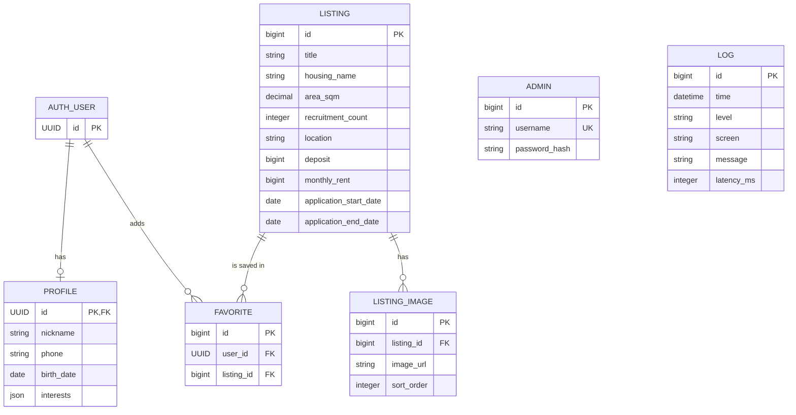
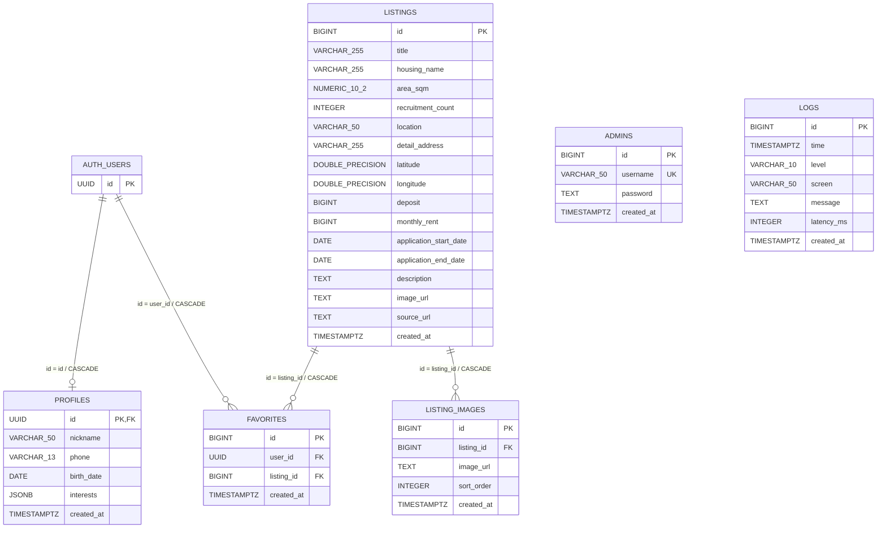

# 1팀 데이터베이스 설계서 - 제출용

> 프로젝트: 공공임대 및 분양 청약 통합 안내 서비스  
> 작성 기준: 저장소의 `BE/sql/*.sql` 및 FastAPI 서비스 코드  
> 데이터베이스: Supabase PostgreSQL  
> 문서 구분: 평가 및 제출용 상세 설계서

## 1. 문서 개요

### 1.1 목적

본 문서는 1팀 서비스에서 사용하는 데이터베이스의 논리·물리 구조를 정의한다. 엔티티와 관계, 카디널리티, 테이블별 컬럼, 데이터 타입, PK·FK, 제약조건, 기본값, 인덱스 및 데이터 처리 흐름을 설명한다.

또한 다음 사항을 확인하는 것을 목적으로 한다.

- 데이터베이스 구조가 서비스 요구사항을 충족하는가?
- 테이블 관계가 실제 백엔드 구현과 일치하는가?
- 데이터 중복과 삽입·갱신·삭제 이상을 최소화했는가?
- API 검증을 우회한 입력에도 DB가 무결성을 보장하는가?
- 주요 검색·정렬 패턴에 필요한 인덱스가 적용되었는가?

### 1.2 서비스 데이터 범위

데이터베이스는 다음 데이터를 관리한다.

1. Supabase Auth 기반 일반 사용자 인증 정보
2. 닉네임·전화번호·생년월일·관심 분야 등의 사용자 추가 정보
3. 관리자 로그인 정보
4. 공공임대·분양 청약 공고와 주택 유형 정보
5. 공고별 다중 이미지와 노출 순서
6. 사용자의 청약 공고 즐겨찾기
7. 서비스에서 발생한 warning/error 운영 로그

### 1.3 데이터베이스 환경

| 항목 | 내용 |
| --- | --- |
| DBMS | Supabase PostgreSQL |
| 인증 저장소 | Supabase Auth `auth.users` |
| 애플리케이션 스키마 | `public` |
| 전체 구성 | 외부 관리 테이블 1개 + `public` 테이블 6개 |
| 문자 인코딩 | UTF-8 |
| 시간 타입 | `TIMESTAMPTZ`(타임존 포함) |
| 기본 키 전략 | `UUID` 또는 `BIGINT GENERATED ALWAYS AS IDENTITY` |
| 데이터 접근 | FastAPI → `supabase-py` → Supabase PostgREST/PostgreSQL |
| 스키마 관리 | `BE/sql`의 SQL 스크립트를 Supabase SQL Editor에서 실행 |

### 1.4 표기 규칙

- PK: 기본 키(Primary Key)
- FK: 외래 키(Foreign Key)
- UK: 유일성 제약(Unique Key)
- NN: `NOT NULL`
- `1:0..1`: 부모 한 건에 자식이 없거나 한 건
- `1:0..N`: 부모 한 건에 자식이 없거나 여러 건
- `ON DELETE CASCADE`: 부모 삭제 시 관련 자식 행도 함께 삭제

## 2. 설계 원칙

### 2.1 인증 정보와 서비스 정보 분리

회원가입, 로그인, 이메일 등의 인증 정보는 Supabase Auth의 `auth.users`가 관리한다. 애플리케이션에서 필요한 닉네임, 연락처, 관심 분야는 `profiles`에 분리해 인증 책임과 서비스 데이터 책임을 구분한다.

### 2.2 테이블의 데이터 단위 명확화

`listings` 한 행의 데이터 단위(grain)는 **동일 공고 내 주택 1개 + 신청 유형(전용면적) 1개**이다. 같은 공고명이라도 주택 또는 면적이 다르면 별도 행으로 저장한다.

### 2.3 반복 데이터 분리

공고 한 건에 여러 이미지가 존재하므로 이미지 URL 배열을 `listings`에 직접 저장하지 않고 `listing_images`로 분리한다. 사용자와 공고의 N:M 관계는 `favorites` 연결 테이블로 해소한다.

### 2.4 무결성의 최종 책임은 DB가 담당

FastAPI/Pydantic에서 요청값을 먼저 검증하고, PostgreSQL의 NOT NULL, CHECK, UNIQUE, FK로 다시 검증한다. API를 우회하거나 동시 요청이 발생해도 데이터베이스가 최종 무결성을 보장한다.

### 2.5 실제 조회 패턴 중심의 인덱스

지역, 보증금, 월세, 신청 기간, 사용자별 즐겨찾기, 공고별 이미지, 최근 로그처럼 실제 화면과 API에서 자주 사용하는 조건을 기준으로 인덱스를 구성한다.

## 3. 핵심 엔티티

| 엔티티 | 역할 | 주요 관계 |
| --- | --- | --- |
| `auth.users` | Supabase가 관리하는 인증 사용자 | `profiles`와 1:0..1, `favorites`와 1:0..N |
| `profiles` | 사용자 추가 정보 | `auth.users`를 PK이자 FK로 참조 |
| `admins` | 관리자 로그인 정보 | 다른 테이블과 직접 관계 없음 |
| `listings` | 청약 공고의 주택·신청 유형 정보 | `listing_images`, `favorites`의 부모 |
| `listing_images` | 공고별 이미지와 노출 순서 | `listings`에 N:1 |
| `favorites` | 사용자와 공고의 즐겨찾기 연결 | `auth.users`, `listings`에 각각 N:1 |
| `logs` | warning/error 운영 로그 이력 | 다른 테이블과 직접 관계 없음 |

## 4. 논리 ERD

논리 ERD는 업무 엔티티의 역할과 카디널리티를 중심으로 표현한다.



`admins`와 `logs`는 독립 엔티티이므로 다른 엔티티와 관계선이 없다.

## 5. 물리 ERD

물리 ERD는 실제 PostgreSQL 테이블명, 핵심 컬럼과 PK·FK를 표현한다.



## 6. 물리 테이블 정의

### 6.1 `profiles` - 사용자 추가 정보

Supabase Auth의 `auth.users`와 PK를 공유하는 확장 테이블이다. 인증 정보는 중복 저장하지 않는다.

| 컬럼 | 타입 | NULL | 키·기본값 | 설명 |
| --- | --- | --- | --- | --- |
| `id` | `UUID` | N | PK, FK → `auth.users(id)`, `ON DELETE CASCADE` | 사용자 식별자 |
| `nickname` | `VARCHAR(50)` | Y | - | 화면에 표시할 닉네임 |
| `phone` | `VARCHAR(13)` | Y | - | 연락처, API에서 `010-0000-0000` 형식 검증 |
| `birth_date` | `DATE` | Y | - | 생년월일 |
| `interests` | `JSONB` | N | `DEFAULT '[]'::jsonb` | 관심 청약 유형 목록 |
| `created_at` | `TIMESTAMPTZ` | N | `DEFAULT now()` | 프로필 생성 시각 |

### 6.2 `admins` - 관리자 계정

관리자는 자체 회원가입 API 없이 발급 스크립트로 생성한다. `password`에는 평문이 아닌 해시 문자열만 저장한다.

| 컬럼 | 타입 | NULL | 키·기본값 | 설명 |
| --- | --- | --- | --- | --- |
| `id` | `BIGINT` | N | PK, Identity | 관리자 식별자 |
| `username` | `VARCHAR(50)` | N | UNIQUE | 관리자 로그인 아이디 |
| `password` | `TEXT` | N | - | 해시된 비밀번호 |
| `created_at` | `TIMESTAMPTZ` | N | `DEFAULT now()` | 계정 생성 시각 |

### 6.3 `listings` - 청약 공고

| 컬럼 | 타입 | NULL | 키·제약·기본값 | 설명 |
| --- | --- | --- | --- | --- |
| `id` | `BIGINT` | N | PK, Identity | 공고 행 식별자 |
| `title` | `VARCHAR(255)` | N | - | 공고명 |
| `housing_name` | `VARCHAR(255)` | N | - | 주택명 |
| `area_sqm` | `NUMERIC(10,2)` | N | CHECK `area_sqm > 0` | 전용면적(㎡) |
| `recruitment_count` | `INTEGER` | N | CHECK `recruitment_count > 0` | 모집 호수 |
| `location` | `VARCHAR(50)` | N | INDEX | 서울시 자치구 |
| `detail_address` | `VARCHAR(255)` | Y | - | 도로명 상세주소 |
| `latitude` | `DOUBLE PRECISION` | Y | CHECK `-90~90` | 지도 표시용 위도 |
| `longitude` | `DOUBLE PRECISION` | Y | CHECK `-180~180` | 지도 표시용 경도 |
| `deposit` | `BIGINT` | N | CHECK `deposit >= 0`, INDEX | 임대보증금(원) |
| `monthly_rent` | `BIGINT` | N | CHECK `monthly_rent >= 0`, INDEX | 월 임대료(원) |
| `application_start_date` | `DATE` | N | DESC INDEX | 신청 시작일 |
| `application_end_date` | `DATE` | N | INDEX | 신청 종료일 |
| `description` | `TEXT` | N | - | 공고 상세 설명 |
| `image_url` | `TEXT` | Y | - | 목록 카드용 대표 이미지 URL |
| `source_url` | `TEXT` | N | - | 공고 원문 URL |
| `created_at` | `TIMESTAMPTZ` | N | `DEFAULT now()` | 등록 시각 |

`listings`의 추가 CHECK 제약조건은 다음과 같다.

| 제약조건 | 규칙 | 목적 |
| --- | --- | --- |
| `ck_listings_area_sqm` | `area_sqm > 0` | 0 이하 면적 방지 |
| `ck_listings_recruitment_count` | `recruitment_count > 0` | 0 이하 모집 호수 방지 |
| `ck_listings_deposit` | `deposit >= 0` | 음수 보증금 방지 |
| `ck_listings_monthly_rent` | `monthly_rent >= 0` | 음수 월세 방지 |
| `ck_listings_application_period` | 종료일 ≥ 시작일 | 잘못된 신청 기간 방지 |
| `ck_listings_latitude` | NULL 또는 -90~90 | 잘못된 위도 방지 |
| `ck_listings_longitude` | NULL 또는 -180~180 | 잘못된 경도 방지 |

### 6.4 `listing_images` - 공고 이미지

공고 한 건에 여러 이미지를 연결하고 노출 순서를 관리한다. `sort_order = 0`은 대표 이미지이며 현재 `listings.image_url`과 같은 URL을 유지한다.

| 컬럼 | 타입 | NULL | 키·제약·기본값 | 설명 |
| --- | --- | --- | --- | --- |
| `id` | `BIGINT` | N | PK, Identity | 이미지 행 식별자 |
| `listing_id` | `BIGINT` | N | FK → `listings(id)`, `ON DELETE CASCADE` | 대상 공고 |
| `image_url` | `TEXT` | N | INDEX | Supabase Storage 공개 URL |
| `sort_order` | `INTEGER` | N | `DEFAULT 0`, CHECK `>= 0` | 노출 순서, 0이 대표 이미지 |
| `created_at` | `TIMESTAMPTZ` | N | `DEFAULT now()` | 등록 시각 |

`UNIQUE(listing_id, sort_order)`로 같은 공고 안에서 이미지 순서가 중복되는 것을 방지한다.

### 6.5 `favorites` - 즐겨찾기

사용자와 청약 공고의 N:M 관계를 해소하는 연결 엔티티이다.

| 컬럼 | 타입 | NULL | 키·제약·기본값 | 설명 |
| --- | --- | --- | --- | --- |
| `id` | `BIGINT` | N | PK, Identity | 즐겨찾기 식별자 |
| `user_id` | `UUID` | N | FK → `auth.users(id)`, `ON DELETE CASCADE`, INDEX | 사용자 식별자 |
| `listing_id` | `BIGINT` | N | FK → `listings(id)`, `ON DELETE CASCADE`, INDEX | 공고 식별자 |
| `created_at` | `TIMESTAMPTZ` | N | `DEFAULT now()` | 즐겨찾기 생성 시각 |

`UNIQUE(user_id, listing_id)`로 한 사용자가 같은 공고를 중복 저장하는 것을 방지한다.

### 6.6 `logs` - 운영 로그 이력

실시간 `info` 로그는 애플리케이션 메모리의 `deque`에만 저장하고, 사후 분석이 필요한 `warning`과 `error` 로그만 DB에 영속 저장한다.

| 컬럼 | 타입 | NULL | 키·제약·기본값 | 설명 |
| --- | --- | --- | --- | --- |
| `id` | `BIGINT` | N | PK, Identity | 로그 식별자 |
| `time` | `TIMESTAMPTZ` | N | DESC INDEX | 로그가 실제 발생한 시각 |
| `level` | `VARCHAR(10)` | N | CHECK `IN ('warning', 'error')`, INDEX | 로그 수준 |
| `screen` | `VARCHAR(50)` | N | - | 로그 발생 화면 또는 기능 |
| `message` | `TEXT` | N | - | 로그 메시지 |
| `latency_ms` | `INTEGER` | N | - | 처리 지연 시간(ms) |
| `created_at` | `TIMESTAMPTZ` | N | `DEFAULT now()` | DB에 저장된 시각 |

## 7. 관계 및 카디널리티

| 부모 → 자식 | 카디널리티 | FK | 삭제 정책 | 설계 이유 |
| --- | --- | --- | --- | --- |
| `auth.users` → `profiles` | 1:0..1 | `profiles.id` | CASCADE | 탈퇴한 사용자의 추가 정보 제거 |
| `auth.users` → `favorites` | 1:0..N | `favorites.user_id` | CASCADE | 탈퇴한 사용자의 즐겨찾기 제거 |
| `listings` → `favorites` | 1:0..N | `favorites.listing_id` | CASCADE | 삭제된 공고를 가리키는 즐겨찾기 방지 |
| `listings` → `listing_images` | 1:0..N | `listing_images.listing_id` | CASCADE | 공고 삭제 시 이미지 메타데이터 제거 |

`profiles`와 `favorites`는 모두 `auth.users`를 참조하지만 서로 직접 FK로 연결하지 않는다. 관리자 즐겨찾기 상세 화면에서 닉네임이 필요하면 `favorites.user_id` 목록으로 `profiles`를 별도 조회한다.

## 8. 정규화 설계

### 8.1 제1정규형(1NF)

각 컬럼은 원칙적으로 하나의 값을 저장한다. 공고의 여러 이미지는 `listing_images`의 개별 행으로 분리해 반복 그룹을 제거했다.

`profiles.interests`는 예외적으로 JSONB 배열을 사용한다. MVP에서 관심 분야는 항목 수가 적고 프로필과 함께 조회·수정되기 때문이다. 관심 분야별 검색과 통계가 중요해지면 별도 테이블로 분리한다.

### 8.2 제2정규형(2NF)

모든 애플리케이션 테이블은 단일 PK를 사용하므로 복합 PK의 일부에만 종속되는 속성이 없다. `favorites`의 업무상 자연 키는 `(user_id, listing_id)`이며 UNIQUE 제약으로 별도 보장한다.

### 8.3 제3정규형(3NF)

- 인증 정보는 `auth.users`에 저장한다.
- 사용자 추가 정보는 `profiles`에 저장한다.
- 공고 정보는 `listings`에 저장한다.
- 반복되는 공고 이미지는 `listing_images`에 저장한다.
- 사용자와 공고의 관계는 `favorites`에 저장한다.
- 운영 로그는 업무 데이터와 분리해 `logs`에 저장한다.

일반 속성이 다른 일반 속성을 통해 간접적으로 키에 종속되지 않도록 역할별로 분리했다. 이에 따라 사용자 정보가 즐겨찾기마다 반복되거나 공고 정보가 이미지마다 반복되는 삽입·갱신·삭제 이상을 방지한다.

### 8.4 의도적 비정규화

| 항목 | 현재 설계 | 적용 이유 | 개선 방향 |
| --- | --- | --- | --- |
| 대표 이미지 | `listings.image_url`과 `listing_images(sort_order=0)`에 중복 | 기존 목록 화면 호환 및 단건 조회 단순화 | `primary_image_id` FK 또는 이미지 테이블 단일화 |
| 관심 분야 | `profiles.interests`를 JSONB 배열로 저장 | 작은 목록을 프로필과 함께 조회·수정 | `interests`, `profile_interests`로 분리 |
| 공고 공통 정보 | 주택·면적별 행에 공고명과 URL 반복 가능 | MVP 등록·조회 로직 단순화 | `announcements`와 `listing_units`로 분리 |

핵심 관계는 3정규화를 기준으로 하며, 위 항목만 MVP 조회 편의와 기존 기능 호환을 위해 제한적으로 비정규화했다.

## 9. 데이터 무결성

| 구분 | 적용 내용 | 방지하는 문제 |
| --- | --- | --- |
| 식별 무결성 | 모든 테이블에 PK 적용 | 중복 행과 식별 불가 방지 |
| 참조 무결성 | `profiles`, `favorites`, `listing_images`에 FK 적용 | 존재하지 않는 사용자·공고 참조 방지 |
| 사용자 삭제 | 관련 프로필·즐겨찾기 CASCADE 삭제 | 탈퇴 사용자 데이터 잔존 방지 |
| 공고 삭제 | 관련 즐겨찾기·이미지 CASCADE 삭제 | 고아 데이터 방지 |
| 중복 방지 | 관리자 ID, 즐겨찾기 조합, 이미지 순서 UNIQUE | 업무상 중복 데이터 방지 |
| 숫자 범위 | 면적·모집 호수 양수, 금액 0 이상 | 유효하지 않은 수치 방지 |
| 신청 기간 | 종료일이 시작일보다 빠를 수 없음 | 잘못된 모집 기간 방지 |
| 지도 좌표 | 위도·경도 범위 검증 | 지도에 표시할 수 없는 좌표 방지 |
| 로그 수준 | warning/error만 허용 | 영속 로그 정책과 다른 값 방지 |

## 10. 인덱스 설계

### 10.1 현재 적용된 인덱스

| 인덱스 | 컬럼 | 사용 패턴 |
| --- | --- | --- |
| `idx_listings_location` | `listings(location)` | 자치구 조건 조회 |
| `idx_listings_deposit` | `listings(deposit)` | 최대 보증금 조회·금액 정렬 |
| `idx_listings_monthly_rent` | `listings(monthly_rent)` | 최대 월세 조회·금액 정렬 |
| `idx_listings_application_start_date` | `listings(application_start_date DESC)` | 신청 시작일 최신순 |
| `idx_listings_application_end_date` | `listings(application_end_date)` | 마감 임박순·마감 여부 확인 |
| `idx_listing_images_listing_id` | `listing_images(listing_id, sort_order)` | 공고별 이미지 순서 조회 |
| `idx_listing_images_image_url` | `listing_images(image_url)` | Storage URL 사용 여부 확인 |
| `idx_favorites_listing_id` | `favorites(listing_id)` | 공고별 즐겨찾기 집계 |
| `idx_favorites_user_id` | `favorites(user_id)` | 사용자 마이페이지 조회 |
| `idx_logs_time` | `logs(time DESC)` | 최근 로그 우선 조회 |
| `idx_logs_level` | `logs(level)` | warning/error 필터 |

PK와 UNIQUE 제약으로 자동 생성되는 인덱스는 표에서 제외했다.

### 10.2 확장 시 검토할 인덱스

아래 항목은 현재 DDL에 적용되지 않은 개선 후보이다. 실제 운영 데이터와 `EXPLAIN ANALYZE` 결과를 확인한 뒤 추가한다.

- `listings(created_at DESC, id DESC)`: 기본 페이지 최신 등록순
- `listings(area_sqm, id DESC)`: 면적 정렬
- `listings(recruitment_count, id DESC)`: 모집 호수 정렬
- `favorites(user_id, created_at DESC)`: 사용자별 최신 즐겨찾기
- `logs(level, time DESC)`: 로그 수준과 최신순 복합 조회

현재 지역 검색은 `ILIKE '%검색어%'`를 사용하므로 일반 B-tree 인덱스가 충분히 활용되지 않을 수 있다. 부분 문자열 검색을 유지한다면 `pg_trgm`과 GIN 인덱스를 검토하고, 자치구 완전 일치 검색으로 변경한다면 `=` 조건을 사용한다.

## 11. 트리거 및 데이터 흐름

### 11.1 사용자 프로필 자동 생성

`auth.users`에 사용자가 생성되면 `on_auth_user_created` 트리거가 `handle_new_user()`를 호출한다. 함수는 회원가입 메타데이터의 닉네임, 전화번호, 생년월일, 관심 분야를 읽어 `profiles`에 저장한다.

```text
Supabase Auth 회원가입
        ↓ INSERT
auth.users
        ↓ AFTER INSERT 트리거
public.handle_new_user()
        ↓ INSERT
public.profiles
```

사용자가 탈퇴하면 `profiles.id`의 `ON DELETE CASCADE`에 의해 프로필도 삭제된다.

### 11.2 공고 및 이미지 저장

공고를 먼저 저장해 `listings.id`를 얻은 뒤, 이미지 URL을 순서대로 `listing_images`에 저장한다.

```text
관리자 공고 등록
        ↓
listings INSERT
        ↓ 생성된 id 사용
listing_images INSERT
```

공고 수정 시 기존 이미지 행을 교체한다. 공고 삭제 시 FK의 CASCADE 정책으로 이미지 메타데이터가 함께 삭제된다. Storage의 실제 파일은 다른 공고의 사용 여부를 확인한 뒤 별도로 삭제한다.

### 11.3 즐겨찾기 저장

```text
사용자 즐겨찾기 요청
        ↓ 사용자·공고 존재 여부를 FK로 확인
favorites INSERT
        ↓ UNIQUE(user_id, listing_id)
중복 저장 차단
```

### 11.4 운영 로그 저장

```text
모든 실시간 로그 → 메모리 deque
warning/error 로그 → logs 테이블에도 영속 저장
```

이를 통해 실시간 조회 성능을 유지하면서 장애 분석에 필요한 중요 로그만 보존한다.

## 12. 생성 및 변경 스크립트

### 12.1 신규 환경 실행 순서

| 순서 | 파일 | 역할 |
| --- | --- | --- |
| 1 | `BE/sql/schema.sql` | `profiles`, `admins`, `listings`, `favorites`, 기본 트리거·인덱스 생성 |
| 2 | `BE/sql/profiles.sql` | 전화번호·생년월일·관심 분야 및 회원가입 트리거 확장 |
| 3 | `BE/sql/alter_listings_coordinates.sql` | 위도·경도와 범위 제약 추가 |
| 4 | `BE/sql/alter_listings_detail_address.sql` | 상세주소 추가, 이미 존재해도 안전하게 건너뜀 |
| 5 | `BE/sql/create_listing_images.sql` | 다중 이미지 테이블·인덱스 생성 |
| 6 | `BE/sql/logs.sql` | 운영 로그 테이블·인덱스 생성 |

`BE/sql/alter_listings.sql`은 이전 버전의 `listings`를 현재 구조로 변경하기 위한 마이그레이션이다. 신규 환경은 최신 `schema.sql`을 사용한다. 기존 데이터가 있는 환경은 백업과 사전 검증 후 트랜잭션 안에서 마이그레이션한다.

### 12.2 초기 데이터 정책

초기 데이터를 SQL로 자동 삽입하지 않는다.

- 일반 사용자: Supabase Auth 회원가입으로 생성
- 프로필: 회원가입 트리거로 생성
- 관리자: `BE/scripts/create_admin.py`로 해시 비밀번호와 함께 생성
- 청약 공고: 관리자 등록 API로 생성
- 즐겨찾기: 사용자 즐겨찾기 API로 생성
- 로그: 애플리케이션 실행 중 자동 생성

## 13. 논리·물리 설계와 구현 일치성

| 논리 개념 | 물리 구현 | 실제 코드 | 결과 |
| --- | --- | --- | --- |
| 인증 사용자 | `auth.users` | Supabase Auth | 일치 |
| 사용자 추가 정보 | `profiles` | `profile_service.py` | 일치 |
| 관리자 | `admins` | `admin_service.py`, `create_admin.py` | 일치 |
| 청약 공고 | `listings` | `listing_service.py` | 일치 |
| 공고 다중 이미지 | `listing_images` | `listing_service.py` | 일치 |
| 사용자 즐겨찾기 | `favorites` | `favorite_service.py` | 일치 |
| 운영 로그 | `logs` | `log_service.py` | 일치 |

백엔드 코드에서 사용하는 테이블과 컬럼은 본 물리 설계에 반영되어 있다. 다만 새 Supabase 환경에서 `schema.sql`만 실행하면 이미지, 로그, 좌표, 프로필 추가 컬럼이 누락되므로 12.1의 후속 스크립트를 모두 실행해야 한다.

## 14. 운영 및 보안 고려사항

- `admins.password`에는 해시된 비밀번호만 저장하고 원문은 저장하지 않는다.
- Supabase Service Role Key는 백엔드에서만 사용하며 프런트엔드에 노출하지 않는다.
- 사용자별 데이터 접근을 DB 수준에서도 제한하려면 `profiles`, `favorites`에 Row Level Security 정책을 적용한다.
- `listing_images` 행 삭제와 Storage 파일 삭제는 별도 과정이므로 다른 공고의 URL 참조 여부를 먼저 확인한다.
- 로그 데이터가 증가하면 보존 기간, 파티셔닝, 아카이빙 정책을 정의한다.
- 스키마 변경 전 백업하고 마이그레이션은 트랜잭션과 실행 후 검증 쿼리를 포함한다.
- 인덱스는 쓰기 비용과 저장 공간을 증가시키므로 실제 실행 계획을 확인해 추가·삭제한다.

## 15. 현재 한계와 개선 방향

| 현재 한계 | 영향 | 개선 방향 |
| --- | --- | --- |
| 공고 공통 정보가 주택·면적별로 반복될 수 있음 | 공고 정보 수정 시 여러 행 갱신 가능 | 공고와 공급 유형 테이블 분리 |
| 대표 이미지 URL이 두 위치에 존재 | 값 불일치 가능 | 단일 기준 컬럼 또는 FK 사용 |
| 관심 분야가 JSONB 배열 | 관심 분야별 조인·통계가 복잡 | 관심 분야 마스터·연결 테이블 도입 |
| 관리자 테이블이 사용자 인증 체계와 분리 | 인증 정책 이원화 | 통합 인증 및 역할 기반 권한 적용 |
| RLS 정책이 SQL 정의에 포함되지 않음 | DB 직접 접근 시 권한 통제가 부족할 수 있음 | 사용자 소유권 기반 RLS 정책 추가 |
| 로그 보존 기간이 정의되지 않음 | 장기 운영 시 테이블 증가 | 보존 기간 및 삭제·아카이빙 작업 추가 |

## 16. 설계 결론

1팀의 데이터베이스는 Supabase Auth와 PostgreSQL을 기반으로 인증 정보와 서비스 데이터를 분리했다. 사용자-공고 즐겨찾기는 연결 테이블로, 공고 이미지는 1:N 자식 테이블로 구성해 핵심 관계를 정규화했다.

FK와 CASCADE 삭제 정책으로 참조 무결성을 유지하고, UNIQUE와 CHECK 제약으로 중복과 잘못된 입력을 차단한다. 위치·금액·신청 기간·즐겨찾기·로그의 실제 조회 패턴에는 인덱스를 적용했다.

대표 이미지, 관심 분야, 공고 공통 정보는 MVP의 조회 편의와 기존 구현 호환을 위해 제한적으로 비정규화했으며, 서비스 확장 시 적용할 분리 방향도 정의했다.
